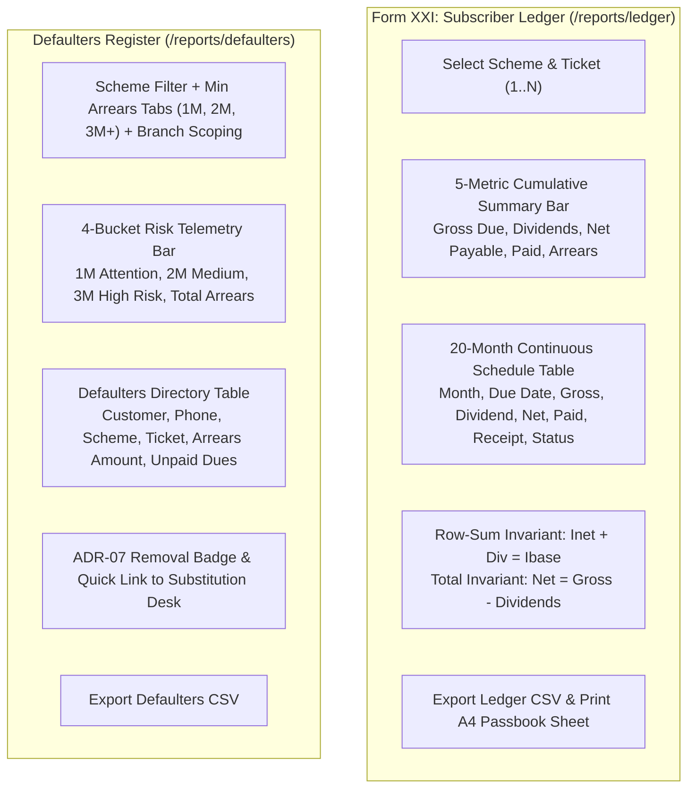

# Form XXI Subscribers' Ledger & Defaulters Register (`/reports/ledger`, `/reports/defaulters`)

> **Product**: **Kumaran Chits** (Kumaran Finance, Perundurai, Tamil Nadu)  
> **Route Paths**:  
>   1. `/reports/ledger` (Statutory Form XXI Continuous Subscriber Ledger)  
>   2. `/reports/defaulters` (Defaulters & Arrears Analysis Register)  
> **Target Personas**: `SUPER_ADMIN`, `ACCOUNTANT`, `BRANCH_MANAGER`, `COLLECTION_AGENT`, `AUDITOR`  
> **Statutory Law**: Tamil Nadu Chit Funds Rules (Form XXI: Subscriber Ledger) & ADR-07 / ADR-12 (Defaulter Removal Protocol)  
> **Status**: **Verified & Complete** (248/248 passing unit tests, 0 TypeScript errors, clean Next.js 15 build)

---

## 1. Overview & Statutory Context

Under the **Tamil Nadu Chit Funds Rules**, every chit fund foreman must maintain **Form XXI: Subscribers' Ledger**. This ledger records the continuous month-by-month financial history for every subscriber ticket across the full term of the chit scheme (20 months), detailing gross base dues ($I_{base}$), universal dividend deductions ($Div_{ticket}$), discounted net dues payable ($I_{net}$), actual amounts paid, receipt numbers, and outstanding arrears.

Alongside Form XXI, management and collection staff require the **Defaulters & Arrears Analysis Register (`/reports/defaulters`)** to track overdue installments, categorize subscribers into default risk tiers (`1-Month Attention`, `2-Month Medium Risk`, `3-Month High Risk Removal`), and exercise company removal rights under **ADR-07** (strict single payment, zero advance/double payments, removal on 3 consecutive unpaid months with 4% damages exit settlement).

---

## 2. Invariant Architectural Guardrails

### 2.1 Form XXI Row-Sum Invariant (Guardrail 4)
- **Every Monthly Row**:
  $$I_{net} + Div_{ticket} \equiv I_{base}$$
- **Full-Term Reconciliations**:
  $$\text{Total Net Payable} \equiv \text{Total Gross Due} - \text{Total Dividend Credits}$$
  $$\text{Total Outstanding Arrears} \equiv \sum_{\text{status} \ne \text{'PAID'}} (I_{net} - \text{paidAmount})$$

### 2.2 ADR-07 & ADR-12 Defaulter Protocol
- `DueStatus` is strictly `UNPAID`, `PAID`, `OVERDUE`.
- Zero double payments, zero partial payments, zero advance balances.
- Consecutive unpaid months counter increments upon monthly arrears scan.
- $\ge 3$ consecutive unpaid months tags the subscriber as **`HIGH_RISK_3M_REMOVAL`**, granting the company statutory removal rights with a 4% foreman commission exit settlement.

### 2.3 Pure Whole Rupee Standard (Guardrail 2)
- All monetary values operate on 64-bit integer Rupees (`bigint`). Paise and decimals are strictly omitted (`formatRupee` from `@kumaran/api-client`).

### 2.4 Single Company Tenancy (Guardrail 1 / ADR-01)
- Zero `company_id` columns, query params, or headers.

---

## 3. UI Component Architecture

| Component | File Path | Line Count | Purpose & Features |
|---|---|:---:|---|
| **Form XXI Ledger Page** | `apps/web/src/app/(dashboard)/reports/ledger/page.tsx` | 280 | Scheme & ticket selector, Form XXI query, CSV & print passbook triggers. |
| **Form XXI KPI Bar** | `apps/web/src/components/reports/form-xxi-kpi-bar.tsx` | 141 | 5 cumulative cards (Gross, Div, Net, Paid, Arrears) with live mathematical check. |
| **Form XXI Table** | `apps/web/src/components/reports/form-xxi-table.tsx` | 240 | 20-month continuous schedule table with row-sum check & @media print layout. |
| **Defaulters Register Page** | `apps/web/src/app/(dashboard)/reports/defaulters/page.tsx` | 329 | Risk filter tabs (1M, 2M, 3M+), branch selector, scheme filter, pagination, CSV export. |
| **Defaulters KPI Bar** | `apps/web/src/components/reports/defaulter-kpi-bar.tsx` | 172 | 4 risk bucket cards (1M, 2M, 3M+, Total Arrears) with ADR-07 removal alert. |
| **Defaulter Analysis Table** | `apps/web/src/components/reports/defaulter-analysis-table.tsx` | 212 | Defaulters directory table, risk badges, itemized unpaid dues expander, quick links. |
| **Reports Landing Hub** | `apps/web/src/app/(dashboard)/reports/page.tsx` | 173 | 5 statutory cards: Form XXII, Form XVII, Form XXI, Defaulters, Audit Logs. |

---

## 4. Automated Test Assertions (`form-xxi-and-defaulters.spec.ts`)

The automated test suite (`apps/web/test/form-xxi-and-defaulters.spec.ts`) validates 8 core invariants:
1. **Form XXI Row-Sum Invariant**: Enforces $I_{net} + Div_{ticket} \equiv I_{base}$ across all 20 monthly rows.
2. **Cumulative Financial Math**: Verifies $\text{Total Net Payable} \equiv \text{Total Gross Due} - \text{Total Dividend Credits}$.
3. **Arrears Summation**: Accurately computes $\text{Total Outstanding Arrears} \equiv \sum \text{unpaid dues}$.
4. **ADR-07 Risk Categorization**: Validates 1M (`ATTENTION_1M`), 2M (`MEDIUM_RISK_2M`), and 3M+ (`HIGH_RISK_3M_REMOVAL`) risk buckets.
5. **ADR-07 Company Removal Rights**: Asserts `eligibleForRemovalRights === true` strictly when `consecutiveUnpaidMonths >= 3`.
6. **RBAC Authority Gates**: Form XXI readable by Staff & Auditor; Defaulters readable by Staff, Agent, Auditor; Customer strictly scoped.
7. **RFC 4180 CSV Export**: Validates ledger and defaulter CSV row formatting with UTF-8 BOM.
8. **100% Bilingual Dictionary Parity**: Asserts 100% key parity between `en.json` and `ta.json` in `reports.ledger` and `reports.defaulters`.
