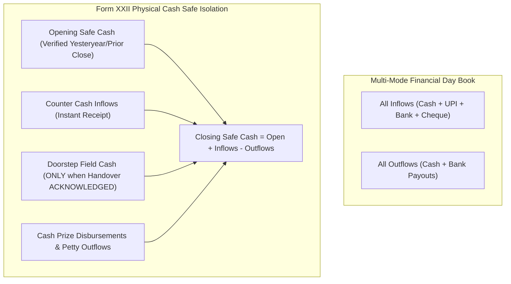

# Form XXII Chit Cash Book & Financial Day Book (`/reports/cash-book`)

> **Product**: **Kumaran Chits** (Kumaran Finance, Perundurai, Tamil Nadu)  
> **Route Path**: `/reports/cash-book` (Form XXII & Day Book), `/reports` (Reports Landing Hub)  
> **Target Personas**: `SUPER_ADMIN`, `ACCOUNTANT`, `BRANCH_MANAGER`, `AUDITOR`  
> **Statutory Law**: Section 23 of Chit Funds Act, 1982 & Tamil Nadu Chit Funds Rules (Form XXII Daily Cash Book)  
> **Status**: **Verified & Complete** (232/232 passing unit tests, 0 TypeScript errors, clean Next.js 15 build)

---

## 1. Overview & Statutory Background

Under **Section 23 of the Chit Funds Act, 1982** and the **Tamil Nadu Chit Funds Rules**, every chit fund foreman must maintain **Form XXII: Daily Cash Book**.

Form XXII tracks the physical currency notes and coins held in the branch safe. It operates alongside the **Multi-Mode Financial Day Book**, which captures all payment modes (`CASH`, `UPI`, `BANK_TRANSFER`, `CHEQUE`) across daily transactions.

---

## 2. Invariant Architectural Guardrails

### 2.1 Statutory Safe Cash Isolation & Doorstep Handover Rule
- **Physical Currency Isolation**: Form XXII strictly isolates hard cash receipts and cash disbursements. Digital payments (UPI, Bank Transfer) bypass physical cash safe balance.
- **Doorstep Collection Timing**: Field cash collected by agents during the day **does NOT enter safe cash immediately**. It is incorporated into Form XXII safe inflows **strictly after** the evening handover is physically counted and approved (`cashHandoverStatus === 'ACKNOWLEDGED'`).
- **Mathematical Balance Invariant**:
  $$\text{Closing Cash in Safe} \equiv \text{Opening Cash in Safe} + \text{Today's Cash Inflows} - \text{Today's Cash Outflows}$$
  The UI renders a green badge when balanced, or an amber warning if a discrepancy occurs.

### 2.2 Whole Rupee Standard (Guardrail 2)
All monetary values are whole-rupee 64-bit integers (`bigint`). Paise and decimals are strictly omitted. Formatting uses `formatRupee(val)` from `@kumaran/api-client` (`₹50,000`, never `₹50,000.00`).

### 2.3 Single-Company Tenancy (Guardrail 1 / ADR-01)
Zero `company_id` columns or headers. Branch context switching is supported for Head Office Perundurai and regional branches.

---

## 3. UI Component Architecture

| Component | File Path | Line Count | Purpose & Features |
|---|---|:---:|---|
| **Reports Landing Hub** | `apps/web/src/app/(dashboard)/reports/page.tsx` | 163 | Statutory cards grid: Form XXII, Form XVII, CA Portal, Inactive Dues, Handover. |
| **Cash Book Orchestrator** | `apps/web/src/app/(dashboard)/reports/cash-book/page.tsx` | 314 | Date/branch navigation, tab switching (Form XXII vs Day Book), CSV export, print trigger. |
| **Reconciliation Pulse Bar** | `apps/web/src/components/reports/cash-book-kpi-bar.tsx` | 136 | 4 KPI cards (Opening Safe, Inflows, Outflows, Closing Safe) with live mathematical balance check. |
| **Date & Branch Navigator** | `apps/web/src/components/reports/report-date-navigator.tsx` | 128 | Native date picker, quick presets (Today, Yesterday, Prev/Next Day), branch selector for Super Admin. |
| **Form XXII 12-Column Table** | `apps/web/src/components/reports/form-xxii-table.tsx` | 270 | Statutory 12-column double-entry split: 6 Receipts columns vs 6 Disbursements columns. |
| **Multi-Mode Day Book Table** | `apps/web/src/components/reports/day-book-table.tsx` | 311 | Method breakdown bar (Cash/UPI/Bank/Cheque) and unified journal with UTR / Cheque references. |
| **RFC 4180 CSV Export Utility** | `apps/web/src/lib/csv-export.ts` | 49 | Universal CSV serializer with UTF-8 BOM (`\uFEFF`) and RFC 4180 compliant escaping. |

---

## 4. Statutory Export & Print Layout

- **CSV Export**: `exportFormXxiiCsv` and `exportDayBookCsv` output formatted spreadsheets with full receipt numbers, subscriber details, voucher references, and whole-rupee amounts.
- **Physical Print (`@media print`)**: Form XXII table includes `@media print` CSS utility hiding non-printable chrome (navigation bars, filter tabs, action buttons) and rendering clean statutory ledger pages ready for Registrar inspection or auditor stamping.

---

## 5. Automated Test Assertions (`form-xxii-cash-book.spec.ts`)

The automated test suite (`apps/web/test/form-xxii-cash-book.spec.ts`) validates 8 invariants:
1. **Physical Safe Cash Inflow**: Strictly counts cash receipts and acknowledged doorstep handovers; ignores pending handovers.
2. **Safe Cash Isolation**: Completely excludes UPI and Bank Transfer payments from Form XXII safe cash.
3. **Closing Safe Balance Invariant**: Verifies $\text{Closing} \equiv \text{Opening} + \text{Inflows} - \text{Outflows}$ across complex multi-branch entries.
4. **Day Book Method Aggregation**: Aggregates inflows by `CASH`, `UPI`, `BANK_TRANSFER`, and `CHEQUE`.
5. **RFC 4180 CSV Export**: Escapes commas, quotes, newlines, and prepends UTF-8 BOM (`\uFEFF`).
6. **Date Navigation**: Correctly traverses Today, Yesterday, and single-day stepping.
7. **RBAC Authority Gate**: Grants read access to `SUPER_ADMIN`, `ACCOUNTANT`, `BRANCH_MANAGER`, `AUDITOR`; denies `COLLECTION_AGENT`.
8. **100% Bilingual Parity**: Validates 73 translation keys between `messages/en.json` and `messages/ta.json`.
