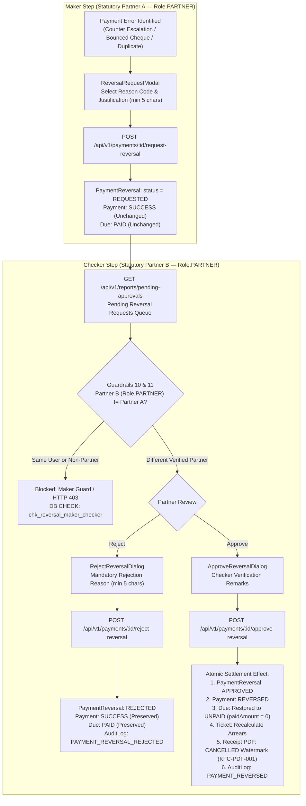

# Payment Reversals & Dual-Control Audit Desk (Web Portal)

> **Product**: **Kumaran Chits**  
> **Company**: **Kumaran Finance** (Head Office — Perundurai, Tamil Nadu)  
> **Route Path**: `/reversals`  
> **Status**: **Phase 8 (Task 8.4) COMPLETED & VERIFIED** (8/8 reversal unit tests passing; **376/376** full Web test suite passing across 52 spec files / 14 suites; 0 TS errors; clean Next.js 15 build across 35 App Router routes)

---

## 1. Overview & Business Reality

Financial transactions recorded in PostgreSQL can **never be deleted** (immutable ledger integrity). When an operational error occurs—such as entering a collection for the wrong ticket number during peak branch counter rush, a subscriber cheque dishonored/bounced during bank clearing, or a network glitch creating a duplicate entry—the correction must be executed strictly through a controlled **Two-Partner Payment Reversal Workflow (`KFC-SEC-001` / Guardrails 10 & 11)**:

> [!IMPORTANT]
> **Verified Partner Exclusivity (`KFC-SEC-001` / Guardrail 11 / `ADR-21` / `ADR-27`)**: While `ACCOUNTANT` and `BRANCH_MANAGER` can view reversal queue status on `/reversals`, all three mutation endpoints (`request-reversal`, `approve-reversal`, `reject-reversal`) are strictly restricted by `PaymentController` (`@Roles(Role.PARTNER)`) and `PaymentService` to **two distinct Statutory Partners (`Role.PARTNER`)**. Desk Accountants, Branch Managers, and IT `SUPER_ADMIN` accounts receive `HTTP 403 Forbidden` and must escalate physical receipts with a written discrepancy memo to Statutory Partner A.

### Key Operational Capabilities

#### A. Maker Step (Statutory Partner A — `Role.PARTNER`, `KFC-SEC-001`)
1. **Error Identification & Search**:
   - Partner A navigates to `/reversals` and clicks **"Request Payment Reversal"**.
   - Enters or pastes Receipt Number (`KC-REC-PRD-2026-00001`) or Payment ID to fetch live payment preview card.
2. **Structured Reason Codes**:
   - `WRONG_TICKET_ENTERED`: Wrong subscriber ticket number entered.
   - `CHEQUE_BOUNCED`: Cheque bounced / dishonored by bank clearing.
   - `DUPLICATE_ENTRY`: Duplicate payment entry recorded by mistake.
   - `CUSTOMER_DISPUTE`: Customer disputed payment allocation.
   - `OTHER`: Other documented justification.
3. **Mandatory Audit Justification**:
   - Minimum 5–10 characters justifying the reversal request (`MANDATORY_JUSTIFICATION`).
   - Optional supporting notes / bank return memo reference.
4. **Initial Request State**:
   - Calls `POST /api/v1/payments/:id/request-reversal`.
   - `PaymentReversal.status` becomes `REQUESTED`.
   - The payment itself remains in `SUCCESS` and the installment due remains `PAID` until authorized.

#### B. Checker Step (Independent Statutory Partner B — `Role.PARTNER`)
1. **Pending Approvals Queue**:
   - Partners inspect pending reversals at `/reversals` retrieved from `GET /api/v1/reports/pending-approvals`.
   - Table displays Reversal ID, Receipt #, Customer Name & Code, Amount ($₹$), Reason, Maker Name, and Date.
2. **Guardrails 10 & 11 (Strict Maker $\ne$ Checker + Statutory Partner Identity)**:
   $$\texttt{initiatedByUserId} \ne \texttt{approvedByUserId} \quad \land \quad \texttt{roles.includes(Role.PARTNER)}$$
   - Enforced in Web UI (`Maker Guard` badge & disabled buttons), NestJS service guards, AND PostgreSQL database `CHECK` constraint (`chk_reversal_maker_checker`, PostgreSQL `23514`).
   - The Partner who requested the reversal **CANNOT** approve or reject it; non-partner staff and IT `SUPER_ADMIN`s are blocked with `PARTNER_IDENTITY_REQUIRED` / `HTTP 403`.
3. **Approval Execution (`POST /api/v1/payments/:id/approve-reversal`)**:
   - Independent Partner B enters optional verification remarks.
   - In an atomic database transaction:
     1. `PaymentReversal.status` transitions from `REQUESTED` $\to$ `APPROVED`.
     2. `Payment.paymentStatus` transitions from `SUCCESS` $\to$ `REVERSED`.
     3. `InstallmentDue.status` restored strictly to `UNPAID` (`paidAmount = 0n`).
     4. Subscriber ticket consecutive unpaid months recalculated (`consecutiveUnpaidMonths`). If unpaid dues $\ge 3$, ticket is flagged `DEFAULT_3_MONTHS`.
     5. Original receipt marked void/reversed; any subsequent A5 web preview or server PDF (`GET /api/v1/pdf/receipt/:paymentId`) stamps a bold diagonal red **`ரத்து செய்யப்பட்டது / CANCELLED`** watermark (`KFC-PDF-001`).
     6. Immutable `AuditLog` entry `PAYMENT_REVERSED` written.
4. **Rejection Execution (`POST /api/v1/payments/:id/reject-reversal`)**:
   - Independent Partner B enters mandatory rejection reason (min 5 characters).
   - In an atomic transaction:
     1. `PaymentReversal.status` transitions from `REQUESTED` $\to$ `REJECTED`.
     2. `Payment.paymentStatus` remains `SUCCESS`.
     3. Due remains `PAID`.
     4. Immutable `AuditLog` entry `PAYMENT_REVERSAL_REJECTED` written.

---

## 2. Invariant Architectural Guardrails & State Machine

---

## 3. Modular File Architecture

All files strictly comply with the modularity limit per **AGENTS.md Rule 4**:

| File Path | Description | Status |
|---|---|:---:|
| `apps/web/src/app/(dashboard)/reversals/page.tsx` | Master reversals route with dual tabs & 4 pulse KPI cards | **Complete** |
| `apps/web/src/components/reversals/reversal-request-modal.tsx` | Maker reversal request dialog with search lookup & reason codes | **Complete** |
| `apps/web/src/components/reversals/reversal-approval-table.tsx` | Pending approvals table with Maker != Checker & Partner guards | **Complete** |
| `apps/web/src/components/reversals/reversal-action-dialogs.tsx` | Dedicated Approve and Reject confirmation dialogs | **Complete** |
| `apps/web/src/lib/query-keys.ts` | Centralized React Query cache keys for reversals | **Complete** |
| `apps/web/test/payment-reversals.spec.ts` | Task 8.4 invariant test suites | **Complete** |

---

## 4. API Integration Endpoints

- **`POST /api/v1/payments/:id/request-reversal`** *(Statutory Partner, `Role.PARTNER`)*: Maker submits reversal request with `{ reason, notes }`.
- **`POST /api/v1/payments/:id/approve-reversal`** *(Independent Statutory Partner, `Role.PARTNER`)*: Authorizes reversal (`maker != checker`, DB `chk_reversal_maker_checker`), reverses ledger, restores due to `UNPAID`, and triggers `KFC-PDF-001` `CANCELLED` receipt watermark.
- **`POST /api/v1/payments/:id/reject-reversal`** *(Independent Statutory Partner, `Role.PARTNER`)*: Rejects reversal with `{ rejectionReason }`.
- **`GET /api/v1/reports/pending-approvals`**: Returns array of pending payment reversals awaiting Checker signoff.
- **`GET /api/v1/payments?paymentStatus=REVERSED`**: Returns historical reversed payments for the audit ledger.

---

## 5. Automated Verification & Quality Gate Proofs

### A. Task 8.4 Invariant Test Results (`apps/web/test/payment-reversals.spec.ts`) — 8/8 Pass
- **Guardrail 10**: Strictly rejects self-approval when `checkerUserId === initiatedByUserId`.
- **Guardrail 11 / `KFC-SEC-001`**: Restricts reversal initiation, approval, and rejection strictly to Statutory Partners (`Role.PARTNER`).
- **Payment State Transition**: Transitions payment strictly from `SUCCESS` $\to$ `REVERSED` upon approval.
- **Due Restoration**: Restores installment due strictly to `UNPAID` with `paidAmount = 0n`.
- **Arrears Recalculation**: Correctly increments unpaid arrears and flags `DEFAULT_3_MONTHS` if unpaid $\ge 3$.
- **Rejection State Preservation**: Rejected reversal preserves payment as `SUCCESS` and due as `PAID`.
- **Mandatory Justification**: Strictly rejects reversal requests without a valid reason (min 5 chars).
- **Bilingual Parity**: All **75** `'reversals'` leaf keys match 100% between `apps/web/messages/en.json` and `ta.json`.

### B. Full Web Workspace Health
- **Total Web Tests**: **376 / 376 tests passing across 52 spec files (14 top-level suites)** (`pnpm --filter web test`).
- **Static Typecheck**: `pnpm --filter web typecheck` exited with **0 errors**.
- **Production Build**: `next build` compiled all **35** App Router `page.tsx` routes cleanly.
- **Bilingual Parity**: 100% bidirectional parity across all 22 namespaces (`1,921` keys each).
