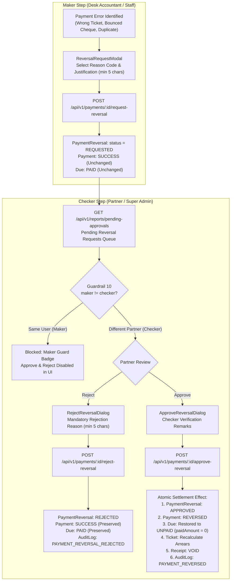

# Payment Reversals & Dual-Control Audit Desk (Web Portal)

> **Product**: **Kumaran Chits**  
> **Company**: **Kumaran Finance** (Head Office — Perundurai, Tamil Nadu)  
> **Route Path**: `/reversals`  
> **Status**: **Phase 8 (Task 8.4) COMPLETED & VERIFIED** (32/32 Phase 8 tests pass, 200/200 full web test suite pass, 0 TS errors, clean Next.js 15 build)

---

## 1. Overview & Business Reality

Financial transactions recorded in PostgreSQL can **never be deleted** (immutable ledger integrity). When an operational error occurs—such as entering a collection for the wrong ticket number during peak branch counter rush, a subscriber cheque dishonored/bounced during bank clearing, or a network glitch creating a duplicate entry—the correction must be executed strictly through a controlled **Payment Reversal Workflow**:

### Key Operational Capabilities

#### A. Maker Step (Desk Accountant / Cashier / Staff)
1. **Error Identification & Search**:
   - Staff navigates to `/reversals` and clicks **"Request Payment Reversal"**.
   - Enters or pastes Receipt Number (`KC-REC-PRD-2026-00001`) or Payment ID to fetch live payment preview card.
2. **Structured Reason Codes**:
   - `WRONG_TICKET_ENTERED`: Wrong subscriber ticket number entered.
   - `CHEQUE_BOUNCED`: Cheque bounced / dishonored by bank clearing.
   - `DUPLICATE_ENTRY`: Duplicate payment entry recorded by mistake.
   - `CUSTOMER_DISPUTE`: Customer disputed payment allocation.
   - `OTHER`: Other documented justification.
3. **Mandatory Audit Justification**:
   - Minimum 5–10 characters justifying the reversal request (`MANDATORY_JUSTIFICATION`).
   - Optional supporting notes / bank return memo reference.
4. **Initial Request State**:
   - Calls `POST /api/v1/payments/:id/request-reversal`.
   - `PaymentReversal.status` becomes `REQUESTED`.
   - The payment itself remains in `SUCCESS` and the installment due remains `PAID` until authorized.

#### B. Checker Step (Partner / Super Admin — Dual Control)
1. **Pending Approvals Queue**:
   - Partners inspect pending reversals at `/reversals` retrieved from `GET /api/v1/reports/pending-approvals`.
   - Table displays Reversal ID, Receipt #, Customer Name & Code, Amount ($₹$), Reason, Maker Name, and Date.
2. **Guardrail 10 (Strict Maker $\ne$ Checker Separation of Duties)**:
   $$\texttt{maker\_user\_id} \ne \texttt{checker\_user\_id}$$
   - The user who requested the reversal **CANNOT** approve or reject it!
   - Action buttons are permanently disabled with a dedicated `Maker Guard` badge and tooltip (`t('selfApprovalBlocked')`).
   - Authority is restricted exclusively to independent **Partners (`SUPER_ADMIN`)**.
3. **Approval Execution (`POST /api/v1/payments/:id/approve-reversal`)**:
   - Partner enters optional verification remarks.
   - In an atomic database transaction:
     1. `PaymentReversal.status` transitions from `REQUESTED` $\to$ `APPROVED`.
     2. `Payment.paymentStatus` transitions from `SUCCESS` $\to$ `REVERSED`.
     3. `InstallmentDue.status` restored strictly to `UNPAID` (`paidAmount = 0n`).
     4. Subscriber ticket consecutive unpaid months recalculated (`consecutiveUnpaidMonths`). If unpaid dues $\ge 3$, ticket is flagged `DEFAULT_3_MONTHS`.
     5. Original receipt marked void/reversed.
     6. Immutable `AuditLog` entry `PAYMENT_REVERSED` written.
4. **Rejection Execution (`POST /api/v1/payments/:id/reject-reversal`)**:
   - Partner enters mandatory rejection reason (min 5 characters).
   - In an atomic transaction:
     1. `PaymentReversal.status` transitions from `REQUESTED` $\to$ `REJECTED`.
     2. `Payment.paymentStatus` remains `SUCCESS`.
     3. Due remains `PAID`.
     4. Immutable `AuditLog` entry `PAYMENT_REVERSAL_REJECTED` written.

---

## 2. Invariant Architectural Guardrails & State Machine

---

## 3. Modular File Architecture

All files strictly comply with the $\le 300\text{--}350$ lines limit per **AGENTS.md Rule 4**:

| File Path | Description | Line Count | Status |
|---|---|:---:|:---:|
| `apps/web/src/app/(dashboard)/reversals/page.tsx` | Master reversals route with dual tabs & 4 pulse KPI cards | 329 | **Complete** |
| `apps/web/src/components/reversals/reversal-request-modal.tsx` | Maker reversal request dialog with search lookup & reason codes | 304 | **Complete** |
| `apps/web/src/components/reversals/reversal-approval-table.tsx` | Pending approvals table with Maker!=Checker guard | 156 | **Complete** |
| `apps/web/src/components/reversals/reversal-action-dialogs.tsx` | Dedicated Approve and Reject confirmation dialogs | 282 | **Complete** |
| `apps/web/src/lib/query-keys.ts` | Centralized React Query cache keys for reversals | 118 | **Complete** |
| `apps/web/test/payment-reversals.spec.ts` | Task 8.4 invariant test suites | 397 | **Complete** |

---

## 4. API Integration Endpoints

- **`POST /api/v1/payments/:id/request-reversal`**: Maker submits reversal request with `{ reason, notes }`.
- **`POST /api/v1/payments/:id/approve-reversal`**: Independent Partner authorizes reversal (`maker != checker`), reverses ledger, and restores due to `UNPAID`.
- **`POST /api/v1/payments/:id/reject-reversal`**: Independent Partner rejects reversal with `{ rejectionReason }`.
- **`GET /api/v1/reports/pending-approvals`**: Returns array of pending payment reversals awaiting Checker signoff.
- **`GET /api/v1/payments?paymentStatus=REVERSED`**: Returns historical reversed payments for the audit ledger.

---

## 5. Automated Verification & Quality Gate Proofs

### A. Task 8.4 Invariant Test Results (`apps/web/test/payment-reversals.spec.ts`) — 8/8 Pass
- **Guardrail 10**: Strictly rejects self-approval when `checkerUserId === initiatedByUserId`.
- **RBAC Authority**: Restricts approval and rejection strictly to `SUPER_ADMIN` (Partners).
- **Payment State Transition**: Transitions payment strictly from `SUCCESS` $\to$ `REVERSED` upon approval.
- **Due Restoration**: Restores installment due strictly to `UNPAID` with `paidAmount = 0n`.
- **Arrears Recalculation**: Correctly increments unpaid arrears and flags `DEFAULT_3_MONTHS` if unpaid $\ge 3$.
- **Rejection State Preservation**: Rejected reversal preserves payment as `SUCCESS` and due as `PAID`.
- **Mandatory Justification**: Strictly rejects reversal requests without a valid reason (min 5 chars).
- **Bilingual Parity**: All 59 reversal keys match 100% between `en.json` and `ta.json`.

### B. Full Web Workspace Health
- **Total Web Tests**: **200 / 200 tests passing** (`pnpm --filter web test`).
- **Static Typecheck**: `tsc --noEmit` exited with **0 errors**.
- **Production Build**: `next build` compiled all 18 routes cleanly.
- **Bilingual Parity**: 100% bidirectional parity across all namespaces.
