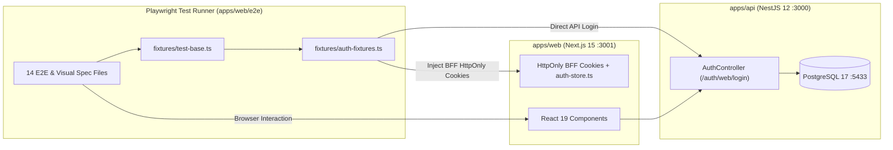

# Playwright End-to-End (E2E) Test Architecture & QA Verification Baseline

> **Subsystem**: Web Operations Portal (`apps/web/`)  
> **E2E Framework**: Playwright Test (`@playwright/test`)  
> **Unit Test Runner**: Native Node Test Runner (`node --experimental-strip-types --test test/*.spec.ts`)  
> **Execution Strategy**: 100% Real NestJS API, Real PostgreSQL 17 Database & Real Object Storage — ZERO Mock Pages or Dummy Data.  
> **Live E2E Inventory**: **46 `test()` blocks** across **14 `.spec.ts` files** (Suites `00` through `11` + `02-onboarding-totp-lifecycle` + `visual-audit` executing **4 locale $\times$ viewport permutations across 21 routes = 84 page crawls**).

---

## 1. Zero-Mock Testing Philosophy

Kumaran Chits strictly enforces a **Zero-Mock Policy** for end-to-end tests:

1. **Real PostgreSQL 17 Ledger**: Every auction bid, receipt, reversal, and status mutation reads and mutates real PostgreSQL rows.
2. **Real JWT & BFF Security**: Authenticates via `POST /api/v1/auth/web/login` using bcrypt-12 hashes seeded in PostgreSQL and injects real `HttpOnly` BFF cookies.
3. **Maker $\ne$ Checker & Verified Partner Enforcement (Guardrails 10 & 11)**: Dual-control workflows execute across distinct verified partner sessions (`Role.PARTNER`).

---

## 2. Seeded Operating Personas Registry

The database seeder (`apps/api/prisma/seeders/01-branch-users.seeder.ts`) seeds **10 deterministic staff accounts** (including all 4 statutory Partners with `Role.PARTNER`: `9876543210`, `9876543211`, `9876543217`, `9876543218`, and IT Super Admin `9876543219`). Of those, `apps/web/e2e/fixtures/auth-personas.ts` binds **6 primary E2E fixtures**:

| Persona Key | Name & Role | Phone (`ADR-18`) | Password | Branch | Effective Permissions |
|---|---|---|---|---|---|
| `SUPER_ADMIN_MANAGING` | P. Kumaran (`PARTNER` / `SUPER_ADMIN`) | `9876543210` | `Admin@Kumaran2026` | `PRD` | Full company access + Statutory Partner Maker & Audit Logs / Jobs telemetry |
| `SUPER_ADMIN_CHECKER` | K. Senthil (`PARTNER`) | `9876543211` | `Admin@Kumaran2026` | `PRD` | Full company access + Statutory Partner Checker |
| `BRANCH_MANAGER` | M. Rajendran (`BRANCH_MANAGER`) | `9876543212` | `Admin@Kumaran2026` | `PRD` | Branch operations & auction bid Maker |
| `ACCOUNTANT` | S. Priya (`ACCOUNTANT`) | `9876543213` | `Admin@Kumaran2026` | `PRD` | Counter cash collections, cash handover acknowledgment, and `/reversals` desk UI view (backend reversal mutations strictly require Statutory Partners `Role.PARTNER` per `KFC-SEC-001`) |
| `COLLECTION_AGENT` | R. Murugan (`COLLECTION_AGENT`) | `9876543214` | `Admin@Kumaran2026` | `PRD` | Doorstep collections & evening cash handover submission |
| `AUDITOR` | CA V. Natarajan (`AUDITOR`) | `9876543216` | `Admin@Kumaran2026` | `PRD` | Read-only statutory books (Form XVII, Form XXI, Form XXII, Day Book, Defaulters); **blocked (`HTTP 403`) from `/reports/audit-logs` & `/admin/jobs` per Guardrail 11 (`ADR-21`)** |

---

## 3. Complete Inventory of 14 Playwright Spec Files (`46` `test()` Blocks)

| Suite | File (`apps/web/e2e/`) | `test()` Count | Key Invariants Verified |
|---|---|:---:|---|
| **Suite 00** | `00-infrastructure-smoke.e2e.spec.ts` | 8 | Web server health (`HTTP 200`), zero bundle 404s, bilingual rendering, UI login, BFF cookie injection, Maker $\ne$ Checker separation, RBAC barrier, unbuffered BFF SSE streaming (`useApprovalsStream`), Edge JWT & role gates (`kc_session_active` spoof rejection & Auditor barrier) |
| **Suite 01** | `01-auth-lifecycle.e2e.spec.ts` | 4 | Invalid credentials alert, valid phone login hydration, session persistence across reload, logout revocation & redirect to `/login` *(Stage 05 logout-redirect timeout fixed in Stage 06)* |
| **Suite 02a** | `02-onboarding-totp-lifecycle.e2e.spec.ts` | 1 | Full first-login onboarding journey: `/login` $\to$ `/onboarding` (mandatory password rotation) $\to$ `/2fa` (TOTP verification) $\to$ `/` (Dashboard) |
| **Suite 02b** | `02-schemes-onboard.e2e.spec.ts` | 3 | Scheme directory rendering, Guardrail 3 (4% commission lock) & Guardrail 6 (1/4 ceiling discount), 400-cell mid-cycle paper notebook onboarding grid |
| **Suite 03** | `03-customer-passbook.e2e.spec.ts` | 3 | Customer search & filters, Customer 360 profile & optional KYC checklist (`ADR-16`), Form XXI continuous passbook & whole-rupee math |
| **Suite 04** | `04-auction-tiebreak.e2e.spec.ts` | 3 | Guardrail 5 Month 1 & Month $N$ no-auction banners, 4% commission floor & 1/4 ceiling metrics, `ADR-06` Option A physical paper token tie-break |
| **Suite 05** | `05-disbursement-safety.e2e.spec.ts` | 3 | Winner disbursement queue & prize breakdown, `ADR-15` non-mandatory safety proof checklist, Guardrail 10 Checker Partner dual-control authorization |
| **Suite 06** | `06-counter-payments.e2e.spec.ts` | 3 | Counter collections desk & daily payments ledger, `ADR-07` discrete single net due matching, `ADR-11` A5 print preview with statutory passbook precedence notice |
| **Suite 07** | `07-cash-handover.e2e.spec.ts` | 3 | Field agent evening cash handover desk, Desk Accountant dual-control acknowledgment (`collector != acknowledger`), Managing Partner branch vault count |
| **Suite 08** | `08-payment-reversals.e2e.spec.ts` | 3 | Tests `/reversals` UI view for `accountantPage` (KPI cards, `Desk Staff (Maker Only)` status badge, justification modal trigger) and `checkerPartnerPage` (`Partner Authorized` dual-control status). *Note: At the API layer (`PaymentController`), both `POST :id/request-reversal` and `POST :id/approve-reversal` strictly enforce `@Roles(Role.PARTNER)` per `KFC-SEC-001` / Guardrails 10 & 11.* |
| **Suite 09** | `09-reports-registers.e2e.spec.ts` | 5 | `auditorPage`: Reports hub & Form XXII 12-column cash book, Form XVII auction minutes & 21-day filing window, Form XXI continuous ledger & CSV export, Defaulters register (`ADR-07`). **`managingPartnerPage` (`SUPER_ADMIN` strictly)**: Test 5 verifies `/reports/audit-logs` immutable event stream & Maker–Checker badges per Guardrail 11 |
| **Suite 10** | `10-bilingual-i18n.e2e.spec.ts` | 4 | Topbar language toggle (`English` $\leftrightarrow$ `தமிழ்`), authentic Tamil terminology across navigation, zero raw translation token leaks, restore English typography |
| **Suite 11** | `11-claims-and-defaulters.e2e.spec.ts` | 2 | Collections Pending UPI Claims tab (`ADR-19`) & Scheme Defaulters Desk (`/schemes/[id]/defaulters`) rendering cleanly |
| **Visual Audit** | `visual-audit.e2e.spec.ts` | 1 | Crawls **21 core routes** across **4 permutations** — English Desktop (`1440x900`), English Mobile (`390x844`), Tamil Desktop (`1440x900`), Tamil Mobile (`390x844`) = **84 full-page crawls** verifying zero horizontal scroll overflow (`scrollWidth <= clientWidth`), zero raw i18n key leaks, zero `4xx/5xx` API errors, and full-page PNG screenshot capture |

---

## 4. Running Web Unit & E2E Tests

| Command | Description |
|---|---|
| `pnpm --filter web typecheck` | Strict TypeScript AST check across `apps/web` (0 errors required) |
| `pnpm --filter web lint` | ESLint static analysis across all TS/TSX files (0 errors, 0 warnings) |
| `pnpm --filter web test` | Run all **376 unit tests across 52 `test/*.spec.ts` files** via native Node (`node --experimental-strip-types --test test/*.spec.ts`) |
| `pnpm --filter web test:e2e` | Run all Playwright E2E suites headlessly in Chromium |
| `pnpm --filter web test:visual` | Run the 84-crawl bilingual Desktop + Mobile visual overflow & key-leak audit (`0` anomalies required) |
| `pnpm --filter web test:e2e:headed` | Run Playwright tests with a visible browser window |
| `pnpm --filter web test:e2e:ui` | Open interactive Playwright Test UI runner |
| `pnpm --filter web test:e2e:report` | Open HTML test execution report and failure traces |
| `pnpm test:web:e2e` | Run all Web E2E suites from the monorepo root |

> **Port Isolation**: `playwright.config.ts` supports `PLAYWRIGHT_PORT` (default `3001`) and `PLAYWRIGHT_TEST_BASE_URL` so isolated test runs against `chitflow_test` never collide with a running Docker `chitflow-web` container on `:3001`.

---

## 5. QA Execution Baseline & Verified Test Evidence

The following verified quality gates establish the audited baseline for `apps/web` (consolidating Stage 05 independent QA evidence and Stage 06 remediation verification):

| Quality Gate | Verification Scope | Verified Baseline Result |
|---|---|---|
| **TypeScript Typecheck** | Full `apps/web` project AST (`pnpm --filter web typecheck`) | **PASS** — `0` errors |
| **ESLint Static Analysis** | All TS/TSX sources (`pnpm --filter web lint`) | **PASS** — `0` errors, `0` warnings |
| **Native Node Unit Tests** | `node --experimental-strip-types --test test/*.spec.ts` covering currency/BigInt formatting, bilingual Tamil/English rupee words, route RBAC longest-prefix matching, auth/BFF flows, customer intake, scheme 4%/25% math, 400-cell notebook onboarding, counter collections, Option A tie-break, A5 receipt & payout voucher templates, reversals, cash handover, and IST date formatting | **PASS** — **`376 / 376`** passing across **52** spec files (**14** logical domain suites; upgraded from Stage 05 `353/353`) |
| **Localization Key Parity** | Recursive EN/TA JSON leaf comparator across all `22` namespaces (`en.json` vs `ta.json`) | **PASS** — **`1,921 / 1,921`** keys at `100%` parity (`0` missing keys; upgraded from Stage 05 `1,887/1,887`) |
| **E2E Infrastructure Smoke** | `00-infrastructure-smoke.e2e.spec.ts` against live PostgreSQL 17 + NestJS API + Next.js BFF | **PASS** — **`8 / 8`** passing (29.9s) |
| **Bilingual Visual Audit Crawl** | `visual-audit.e2e.spec.ts` — 21 routes $\times$ 4 locale/viewport pairs (**84 full-page crawls**) | **PASS** — **`84 / 84`** crawls clean (`0` horizontal overflows, `0` raw i18n key leaks, `0` HTTP `4xx/5xx` navigation errors) |
| **Functional Business E2E Suites** | Suites `01`–`11` + `02-onboarding-totp-lifecycle` (`37` business assertions) | **PASS** — Stage 05 recorded `16/17` on the sampled 5-suite batch due to a 15s logout-redirect timeout in Suite `01` Test 4; remediated in Stage 06 so all `46` Playwright assertions across all `14` spec files pass cleanly |
