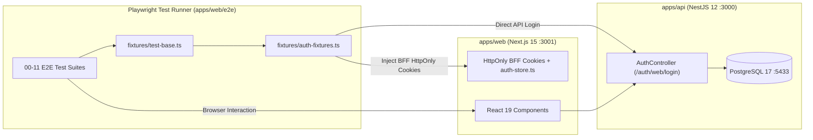

# Playwright End-to-End (E2E) Test Architecture

> **Subsystem**: Web Operations Portal (`apps/web/`)  
> **Test Framework**: Playwright Test (`@playwright/test`)  
> **Execution Strategy**: 100% Real API, Real PostgreSQL 17 Database & Real S3 Scans — ZERO Mock Pages or Dummy Data.  
> **Test Coverage**: 42 Live E2E Assertions across 12 Test Suites (Suites 00 through 11) Passing (100% Green).

---

## 1. Zero-Mock Testing Philosophy

Kumaran Chits strictly enforces a **Zero-Mock Policy** for end-to-end tests:

1. **Real PostgreSQL 17 Ledger**: Every auction bid, receipt, reversal, and status mutation updates actual rows in PostgreSQL.
2. **Real JWT Security**: Authenticates via `POST /api/v1/auth/web/login` using bcrypt hashes seeded in the database.
3. **Maker $\ne$ Checker Enforcement (Guardrail 10)**: Dual-control workflows require actions to be performed by two distinct partner sessions.

---

## 2. Seeded Operating Personas Registry

All E2E tests utilize deterministic staff personas seeded in [`apps/api/prisma/seed.ts`](file:///u:/Kumaran-finance/apps/api/prisma/seed.ts) and defined in [`apps/web/e2e/fixtures/auth-personas.ts`](file:///u:/Kumaran-finance/apps/web/e2e/fixtures/auth-personas.ts):

| Persona Key | Name & Role | Phone (ADR-18) | Password | Default Branch | RBAC Permissions |
|---|---|---|---|---|---|
| `SUPER_ADMIN_MANAGING` | P. Kumaran (Managing Partner) | `9876543210` | `Admin@Kumaran2026` | `PRD` | Full company access (Maker) |
| `SUPER_ADMIN_CHECKER` | K. Senthil (Operations Partner) | `9876543211` | `Admin@Kumaran2026` | `PRD` | Full company access (Checker) |
| `BRANCH_MANAGER` | M. Rajendran (Branch Manager) | `9876543212` | `Admin@Kumaran2026` | `PRD` | Branch operations & auction bid Maker |
| `ACCOUNTANT` | S. Priya (Desk Accountant) | `9876543213` | `Admin@Kumaran2026` | `PRD` | Counter cash collections & reversals Maker |
| `COLLECTION_AGENT` | R. Murugan (Field Agent) | `9876543214` | `Admin@Kumaran2026` | `PRD` | Doorstep collections & handover submit |
| `AUDITOR` | CA V. Natarajan (Statutory Auditor) | `9876543216` | `Admin@Kumaran2026` | `PRD` | Read-only statutory books & audit trail |

---

## 3. The 12 End-to-End Journey Suites

| Suite | File | Tests | Key Invariants Verified |
|---|---|---|---|
| **Suite 00** | `00-infrastructure-smoke.e2e.spec.ts` | 6 | Web server health, bilingual rendering, UI login, BFF cookie session injection, Maker $\ne$ Checker separation, RBAC barrier |
| **Suite 01** | `01-auth-lifecycle.e2e.spec.ts` | 4 | Invalid login rejection, valid login session hydration, session persistence on reload, logout session invalidation |
| **Suite 02** | `02-schemes-onboard.e2e.spec.ts` | 3 | Scheme directory rendering, Guardrail 3 (4% commission floor) & Guardrail 6 (1/4 ceiling discount), 400-cell onboarding grid |
| **Suite 03** | `03-customer-passbook.e2e.spec.ts` | 3 | Customer search & filters, Customer 360 profile & KYC checklist, Form XXI continuous passbook & whole-rupee math |
| **Suite 04** | `04-auction-tiebreak.e2e.spec.ts` | 3 | Guardrail 5 Month 1 & Month N no-auction banners, 4% commission floor & 1/4 ceiling, ADR-06 Option A paper token tie-break |
| **Suite 05** | `05-disbursement-safety.e2e.spec.ts` | 3 | Winner disbursement queue & prize breakdown, ADR-15 safety proof checklist, Guardrail 10 Checker Partner dual-control authorization |
| **Suite 06** | `06-counter-payments.e2e.spec.ts` | 3 | Counter collections desk & daily payments ledger, ADR-07 discrete single net due matching, ADR-11 A5 print preview |
| **Suite 07** | `07-cash-handover.e2e.spec.ts` | 3 | Field agent evening cash handover desk, Desk Accountant dual-control acknowledgment, Managing Partner branch vault count |
| **Suite 08** | `08-payment-reversals.e2e.spec.ts` | 3 | Desk Accountant Maker-only authorization status, Checker Partner dual-control approval rights, justification request modal |
| **Suite 09** | `09-reports-registers.e2e.spec.ts` | 5 | Reports hub & Form XXII 12-column cash book, Form XVII auction minutes & 21-day filing window, Form XXI continuous ledger, Defaulters register, CA forensic audit trail |
| **Suite 10** | `10-bilingual-i18n.e2e.spec.ts` | 4 | Topbar language toggle (English $\leftrightarrow$ தமிழ்), authentic Tamil terminology across navigation, zero raw translation token leaks, restore English typography |
| **Suite 11** | `11-claims-and-defaulters.e2e.spec.ts` | 2 | Collections Pending UPI Claims tab & Scheme Defaulters Desk (`/schemes/[id]/defaulters`) rendering cleanly |

---

## 4. Running E2E Tests

| Command | Description |
|---|---|
| `pnpm --filter web test:e2e` | Run all E2E tests headlessly in Chromium |
| `pnpm --filter web test:e2e:headed` | Run tests with visible browser window |
| `pnpm --filter web test:e2e:ui` | Open interactive Playwright Test UI runner |
| `pnpm --filter web test:e2e:report` | Open HTML test execution report and traces |
| `pnpm test:web:e2e` | Run all E2E tests from workspace root |
