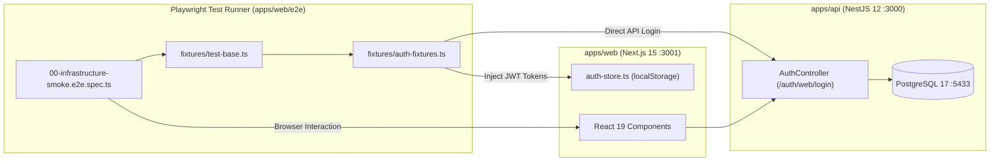

# Playwright End-to-End (E2E) Test Architecture

> **Subsystem**: Web Operations Portal (`apps/web/`)  
> **Test Framework**: Playwright Test (`@playwright/test`)  
> **Execution Strategy**: 100% Real API, Real PostgreSQL 17 Database & Real AWS S3 Scans — ZERO Mock Pages or Dummy Data.

---

## 1. Zero-Mock Testing Philosophy

Kumaran Chits strictly enforces a **Zero-Mock Policy** for end-to-end tests:



1. **Real PostgreSQL 17 Ledger**: Every auction bid, receipt, reversal, and status mutation updates actual rows in PostgreSQL.
2. **Real JWT Security**: Authenticates via `POST /api/v1/auth/web/login` using bcrypt hashes seeded in the database.
3. **Maker $\ne$ Checker Enforcement (Guardrail 10)**: Dual-control workflows require actions to be performed by two distinct partner sessions.

---

## 2. Seeded Operating Personas Registry

All E2E tests utilize deterministic staff personas seeded in [`apps/api/prisma/seed.ts`](file:///u:/Kumaran-finance/apps/api/prisma/seed.ts) and defined in [`apps/web/e2e/fixtures/auth-personas.ts`](file:///u:/Kumaran-finance/apps/web/e2e/fixtures/auth-personas.ts):

| Persona Key | Name & Role | Phone (ADR-18) | Password | Default Branch | RBAC Permissions |
|---|---|---|---|---|---|
| `SUPER_ADMIN_MANAGING` | P. Kumaran (Managing Partner) | `9876543210` | `Admin@Kumaran2026` | `PRD` | Full company access (Maker) |
| `SUPER_ADMIN_CHECKER` | K. Senthil (Operations Partner) | `9876543211` | `Admin@Kumaran2026` | `PRD` | Full company access (Checker) |
| `BRANCH_MANAGER` | M. Rajendran (Branch Manager) | `9876543212` | `Admin@Kumaran2026` | `PRD` | Branch operations & auction bid Maker |
| `ACCOUNTANT` | S. Priya (Desk Accountant) | `9876543213` | `Admin@Kumaran2026` | `PRD` | Counter cash collections & reversals Maker |
| `COLLECTION_AGENT` | R. Murugan (Field Agent) | `9876543214` | `Admin@Kumaran2026` | `PRD` | Doorstep collections & handover submit |
| `AUDITOR` | CA V. Natarajan (Statutory Auditor) | `9876543216` | `Admin@Kumaran2026` | `PRD` | Read-only statutory books & audit trail |

---

## 3. Dual-Mode Authentication Fixtures

The test infrastructure in [`apps/web/e2e/fixtures/auth-fixtures.ts`](file:///u:/Kumaran-finance/apps/web/e2e/fixtures/auth-fixtures.ts) provides two execution modes:

### Mode A: Fast API Session Injection (Recommended for Functional Journeys)
```typescript
import { test, expect } from './fixtures/test-base';

test('Fast authenticated journey', async ({ managingPartnerPage }) => {
  // Page lands directly on / with authenticated JWT session pre-injected into localStorage
  await managingPartnerPage.goto('/schemes');
  await expect(managingPartnerPage.locator('h1')).toContainText('Chit Schemes');
});
```

### Mode B: Real UI Form Login (For Auth & Validation Verification)
```typescript
import { test } from '@playwright/test';
import { AUTH_PERSONAS } from './fixtures/auth-personas';
import { loginViaUi } from './fixtures/auth-fixtures';

test('Full UI login flow', async ({ page }) => {
  // Fills 10-digit phone, password, clicks submit, and waits for URL redirect
  await loginViaUi(page, AUTH_PERSONAS.SUPER_ADMIN_MANAGING);
});
```

---

## 4. Running E2E Tests

| Command | Description |
|---|---|
| `pnpm --filter web test:e2e` | Run all E2E tests headlessly in Chromium |
| `pnpm --filter web test:e2e:headed` | Run tests with visible browser window |
| `pnpm --filter web test:e2e:ui` | Open interactive Playwright Test UI runner |
| `pnpm --filter web test:e2e:report` | Open HTML test execution report and traces |
| `pnpm test:web:e2e` | Run E2E tests from workspace root |
