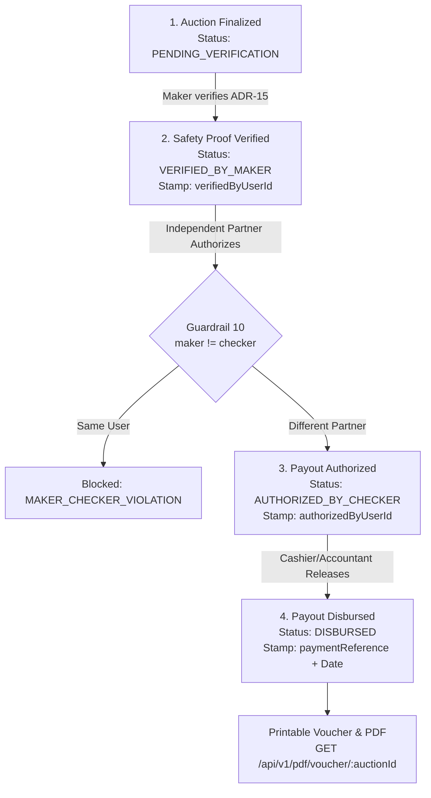

# Prize Money Disbursements & Dual-Control Settlement Desk (`/disbursements`)

> **Module**: **Prize Disbursements & Maturity Settlements**  
> **Route Paths**: `/disbursements`, `/disbursements/[id]/voucher`  
> **Primary Specification**: [`docs/01-business/decision-log.md`](../01-business/decision-log.md) (ADR-10, ADR-14, ADR-15), [`docs/03-architecture/api-spec.md`](../03-architecture/api-spec.md)  
> **Target Personas**: Super Admin (Partner Maker/Checker), Branch Manager, Accountant, Cashier, Auditor  
> **Status**: **Phase 7 (Tasks 7.1 & 7.2) 100% Complete & Verified** (168/168 passing tests, 0 TypeScript errors, clean Next.js 15 build)

---

## 1. Architectural Invariants & Business Rules

### 1.1 Pure Whole Rupee Net Prize Math (Guardrail 2 & Chit Fundamentals)
Net Prize Money payable to the auction winner is calculated as:
$$P = V - D$$
where:
- $V$: Gross chit scheme pool value (e.g. ₹1,00,000, ₹5,00,000, ₹10,00,000)
- $D$: Winning auction bid discount entered in auction ($D \le \frac{V}{4}$)
- $C_f$: 4.00% Foreman Commission frozen per ADR-04 ($C_f = V \times 0.04$)
- All numbers operate on 64-bit integer Rupees (`BigInt`); paise, decimal fractions, and IEEE 754 floats are strictly prohibited.

### 1.2 ADR-15: Complete Elimination of Property Documents
Per **ADR-15 (`CONFIRMED-BY-DEVELOPER`)**:
- Traditional property deeds, land registrations, patta records, and encumbrance certificates are **completely eliminated**.
- Collateral/surety is **not mandatory across the board** and is evaluated strictly on-demand for company safety (`isSecurityRequired: boolean`).
- Permitted on-demand safety proof instruments:
  1. Signed formal chit agreement with winner (`agreementSigned: boolean`, mandatory)
  2. Nominee personal guarantee undertaking (`nomineeSigned: boolean`, mandatory)
  3. Signed blank cheques (`blankChequeDetails: string`, optional/on-demand)
  4. Scanned upload of cheques/agreement stored in **private AWS S3** (`POST /api/v1/disbursements/auction/:auctionId/upload-safety-proof`)

### 1.3 ADR-14: Unlimited Hard Cash Prize Disbursements
Per **ADR-14 (`CONFIRMED-BY-DEVELOPER`)**:
- Kumaran Finance operates strictly with physical vault cash and banking instruments in Tamil Nadu.
- The web app enforces **zero artificial cash payout caps** or restrictions.
- Hard cash payouts (`disbursementMode: 'CASH'`) are fully supported for any legal prize amount (e.g., ₹75,000, ₹4,00,000, or higher) with on-counter handover and signed physical voucher receipt.

### 1.4 Guardrail 10: Strict Maker $\ne$ Checker Dual-Control
- **Hard Guard**: The staff user who verified the safety proof checklist (Maker: `verifiedByUserId`) **CANNOT** authorize the payout voucher.
- An independent **Partner (Super Admin)** must review the checklist, select the disbursement mode (`ACCOUNT_PAYEE_CHEQUE`, `BANK_TRANSFER_NEFT`, `BANK_TRANSFER_RTGS`, `BANK_TRANSFER_IMPS`, or `CASH`), and authorize the release.
- Client-side alert banner (`makerGuardAlert`) disables self-authorization, backed by database-level exception (`MAKER_CHECKER_VIOLATION`).

### 1.5 Month $N$ Maturity Settlement (Section 16 Chit Rules)
- In the final month ($N$), full chit pool is settled directly to the single remaining unprized subscriber **without auction** ($D = 0$).
- Net payout: $P = V - C_f$ ($V$ minus 4.00% Foreman Commission).
- Super Admin executes final settlement via `POST /api/v1/disbursements/group/:chitGroupId/final-settlement` $\to$ transitions ticket to `isPrized = true` and scheme status to `COMPLETED`.

---

## 2. Dual-Control Workflow State Machine



---

## 3. Real Backend API Contracts & Endpoints

| HTTP Method | API Endpoint | Description | Permitted Roles | Frontend Component / Action |
|---|---|---|---|---|
| `GET` | `/api/v1/disbursements` | Paginated list of disbursements with filters (`status`, `chitGroupId`, `mode`, date range) | `SUPER_ADMIN`, `BRANCH_MANAGER`, `ACCOUNTANT`, `AUDITOR` | `DisbursementsTable` |
| `GET` | `/api/v1/disbursements/auction/:auctionId` | Full winner details, ticket, customer, chitGroup, maker/checker audit metadata | Staff & Auditor | `PayoutVoucherPage` |
| `POST` | `/api/v1/disbursements/auction/:auctionId/upload-safety-proof` | Multipart S3 upload (max 10MB, JPG/PNG/WEBP/PDF) | `SUPER_ADMIN`, `BRANCH_MANAGER`, `ACCOUNTANT` | `SafetyProofUploadBox` |
| `GET` | `/api/v1/disbursements/auction/:auctionId/safety-proof-url` | Generates 15-minute (900s) time-limited S3 presigned URL for document preview | Staff & Auditor | `SafetyProofUploadBox` |
| `POST` | `/api/v1/disbursements/auction/:auctionId/verify-safety-proof` | Maker records ADR-15 verification: `agreementSigned`, `nomineeSigned`, blank cheques | `SUPER_ADMIN`, `BRANCH_MANAGER`, `ACCOUNTANT` | `SafetyProofChecklist` |
| `POST` | `/api/v1/disbursements/auction/:auctionId/authorize-payout` | Checker authorizes payout mode and whole-rupee amount (`maker != checker`) | `SUPER_ADMIN` strictly | `DisbursementAuthModal` |
| `POST` | `/api/v1/disbursements/auction/:auctionId/disburse` | Cashier releases payout with mandatory `paymentReference` | `SUPER_ADMIN`, `ACCOUNTANT` | `DisbursementReleaseModal` |
| `GET` | `/api/v1/disbursements/auction/:auctionId/voucher` | Formatted bilingual voucher parameters and monospace text | Staff & Auditor | `BilingualVoucherDialog` |
| `GET` | `/api/v1/pdf/voucher/:auctionId` | Streams official bilingual A4/A5 PDF voucher for member physical signing | Staff & Auditor | `BilingualVoucherDialog` |
| `POST` | `/api/v1/disbursements/group/:chitGroupId/final-settlement` | Executes Month N maturity settlement ($P = V - C_f$) to final unprized subscriber | `SUPER_ADMIN` strictly | `FinalSettlementModal` |

---

## 4. Frontend Component Breakdown & File Sizing

All components and pages are strictly written $\le 300\text{--}350$ lines per **AGENTS.md Rule 4**:

```
apps/web/
├── src/
│   ├── app/(dashboard)/disbursements/
│   │   ├── page.tsx                           # Master queue with 4 metrics & status tabs (201 lines)
│   │   └── [id]/voucher/page.tsx              # Voucher detail, Maker guard & modal orchestration (266 lines)
│   ├── components/disbursements/
│   │   ├── disbursements-table.tsx            # Master disbursements data table with status badges (251 lines)
│   │   ├── safety-proof-checklist.tsx         # Maker verification form with ADR-15 checklist (318 lines)
│   │   ├── safety-proof-upload-box.tsx        # S3 multipart upload & 15-min presigned URL preview (138 lines)
│   │   ├── payout-voucher-card.tsx            # 4-column financial breakdown & progress stepper (260 lines)
│   │   ├── disbursement-auth-modal.tsx        # Checker authorization dialog with Maker != Checker guard (278 lines)
│   │   ├── disbursement-release-modal.tsx     # Cashier/Accountant payout release dialog (263 lines)
│   │   ├── bilingual-voucher-dialog.tsx       # Printable voucher viewer & PDF download trigger (205 lines)
│   │   └── final-settlement-modal.tsx         # Month N maturity settlement modal (266 lines)
└── test/
    ├── prize-disbursements.spec.ts            # Task 7.1 invariant tests (372 lines)
    └── disbursement-authorization.spec.ts     # Task 7.2 Maker-Checker & release tests (338 lines)
```

---

## 5. Automated Test Suite Proofs

Two dedicated automated test suites verify Phase 7 invariants:

### Test Suite 1: Task 7.1 (`apps/web/test/prize-disbursements.spec.ts`)
```
▶ Task 7.1: Prize Disbursements Queue & Safety Proof Checklist Unit Tests
  ✔ Financial Invariant: Net Prize Money is strictly P = V - D in whole integer Rupees
  ✔ ADR-15 Invariant: Property documents (deeds/patta) are eliminated from checklist & DTO
  ✔ ADR-15 Invariant: Mandatory boolean signatures for chit agreement & nominee guarantee
  ✔ Disbursement Workflow: Transitions PENDING_VERIFICATION to VERIFIED_BY_MAKER with Maker stamp
  ✔ S3 Upload Guard: Allows JPG, PNG, WEBP, PDF up to 10MB and rejects invalid MIME/size
  ✔ S3 Presigned URL Security Guard: Viewing URL expires in strictly 900 seconds (15 minutes)
  ✔ ADR-14 Invariant: Unlimited hard cash payouts permitted with zero artificial software caps
  ✔ Bilingual Parity: 100% key match between en.json and ta.json in disbursements namespace
✔ Task 7.1: Prize Disbursements Queue & Safety Proof Checklist Unit Tests (8/8 pass)
```

### Test Suite 2: Task 7.2 (`apps/web/test/disbursement-authorization.spec.ts`)
```
▶ Task 7.2: Maker != Checker Prize Money Payout Release & Final Settlement Unit Tests
  ✔ Guardrail 10: Rejects self-authorization when currentUser.id === verifiedByUserId
  ✔ Guardrail 10: Allows independent Super Admin (Partner B) to authorize payout
  ✔ RBAC Authority: Restricts payout authorization strictly to SUPER_ADMIN
  ✔ State Machine: Authorization strictly requires status VERIFIED_BY_MAKER
  ✔ Payout Release: Requires AUTHORIZED_BY_CHECKER and mandatory paymentReference
  ✔ ADR-14 Invariant: Unlimited hard cash payouts permitted without software caps
  ✔ Month N Invariant: Direct settlement calculates P = V - Cf with D = 0 and marks COMPLETED
  ✔ Bilingual Parity: 100% key parity between English and Tamil for disbursements namespace
✔ Task 7.2: Maker != Checker Prize Money Payout Release & Final Settlement Unit Tests (8/8 pass)
```

### Overall Workspace Health
- **Total Test Count**: **168 / 168 tests passing** (`pnpm --filter web test`).
- **TypeScript Typecheck**: `tsc --noEmit` exited with **0 errors**.
- **Production Build**: `next build` compiled all routes cleanly into optimized production bundles.
- **Bilingual Dictionary Parity**: 116 keys in `en.json` $\longleftrightarrow$ 116 keys in `ta.json` under `disbursements` (0 missing keys).
