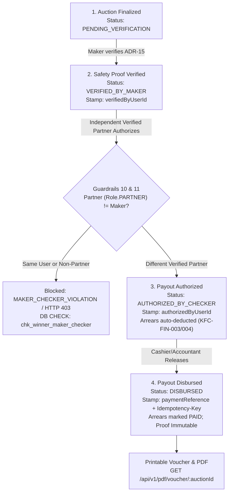

# Phase 7 Architecture: Prize Disbursements & Company Safety Proof Checklist

> **Product**: **Kumaran Chits** (Kumaran Finance, Perundurai, Tamil Nadu)  
> **Platform**: Web Workstation Portal (`apps/web`)  
> **Module**: **Phase 7 — Prize Disbursements & Maturity Settlements** (Tasks 7.1 & 7.2)  
> **Route Paths**: `/disbursements`, `/disbursements/[id]/voucher`  
> **Primary Specification**: [`docs/01-business/decision-log.md`](../01-business/decision-log.md) (ADR-10, ADR-14, ADR-15), [`docs/03-architecture/api-spec.md`](../03-architecture/api-spec.md)  
> **Target Personas**: Statutory Partner (`Role.PARTNER`, Maker/Checker), Branch Manager, Accountant, Cashier, Auditor  
> **Status**: **Phase 7 (Tasks 7.1 & 7.2) 100% COMPLETE & VERIFIED** (16/16 Phase 7 unit tests passing; **376/376** full Web test suite passing across 52 spec files / 14 suites; 0 TypeScript errors; clean Next.js 15 standalone build across 35 App Router routes)

---

## 1. Executive Summary & Problem Scope

In Kumaran Chits, prize money disbursement to an auction winner is a high-liability operation requiring strict statutory compliance, physical recordkeeping, and dual-control separation of duties:
1. **Task 7.1 (Prize Disbursements Queue & Safety Proof Checklist)**:
   - Route `/disbursements` tracks all finalized auctions awaiting member verification and payout release.
   - 4 Top-level Metric Cards: Total Prize Winners, Pending Safety Verification, Authorized by Checker, Total Rupee Prize Outflow.
   - Filter tabs: `ALL`, `PENDING_VERIFICATION`, `VERIFIED_BY_MAKER`, `AUTHORIZED_BY_CHECKER`, `DISBURSED`.
   - **ADR-15 Company Safety Proof Checklist**: Property documents (land deeds, patta, ec) are completely eliminated. The software records on-demand safety proof: signed formal chit agreement (`agreementSigned: boolean`), nominee personal guarantee (`nomineeSigned: boolean`), signed blank cheques (`blankChequeDetails: string`), and scanned uploads via **Direct Presigned S3/R2 PUT** (`uploadDirectToStorage` $\to$ `POST /api/v1/storage/presigned-upload-url` up to **10 MB** + `POST /api/v1/disbursements/auction/:auctionId/confirm-safety-proof`, with 5 MB multipart fallback; immutable once `DISBURSED` per `DISBURSED_PRIZE_IMMUTABLE`), viewed solely via 15-minute presigned URLs (`GET /api/v1/disbursements/auction/:auctionId/safety-proof-url`).
   - Maker records safety verification stamping `verifiedByUserId` and transitions status to `VERIFIED_BY_MAKER`.
2. **Task 7.2 (Maker $\ne$ Checker Prize Money Payout Release & Final Settlement)**:
   - Route `/disbursements/[id]/voucher` enforces **Guardrails 10 & 11 (`ADR-27`)**: a Maker who verified the safety proof **CANNOT** authorize the payout voucher (`verifiedByUserId != authorizedByUserId`, backed by PostgreSQL `chk_winner_maker_checker`), and Checker authorization requires a **Statutory Partner (`Role.PARTNER`)**.
   - An independent **Partner B (`Role.PARTNER`)** reviews the verified checklist, selects the disbursement mode (`ACCOUNT_PAYEE_CHEQUE`, `BANK_TRANSFER_NEFT`, `BANK_TRANSFER_RTGS`, `BANK_TRANSFER_IMPS`, or `CASH`), and authorizes the release.
   - **ADR-14 Unlimited Hard Cash Payouts**: Enforces zero artificial cash payout caps for physical cash releases at the Perundurai head office counter.
   - Cashier/Accountant executes the final disbursement release with mandatory `paymentReference` and safe network retry via `Idempotency-Key` header or `dto.idempotencyKey`.
   - Monospace & bilingual voucher dialog with direct browser print (`window.print()`) and official A4/A5 PDF download via `GET /api/v1/pdf/voucher/:auctionId`.
   - **Prior Arrears Auto-Offset (`KFC-FIN-003`, `KFC-FIN-004`)**: Unpaid installments are automatically queried and deducted from the gross prize snapshot; payout overrides deviating from authorized net entitlement fail closed (`PAYOUT_OVERRIDE_NOT_PERMITTED`).
   - **Month $N$ Final Maturity Settlement Two-Stage Workflow (`KFC-FIN-001`, `FIN-B`, `F05`)**: Directly settles the final unprized subscriber pool without auction ($D = 0, P = V - C_f - \text{finalMonthDeduction} - \text{priorArrears}$) strictly under two-stage dual control:
     1. **Stage 1 (Maker Preparation)**: `POST /api/v1/disbursements/group/:chitGroupId/prepare-final-settlement` (Staff calculates deductions and persists the prepared settlement voucher with Stage-1 `conductedByUserId = makerUserId`).
     2. **Stage 2 (Checker Approval)**: `POST /api/v1/disbursements/group/:chitGroupId/approve-final-settlement` (Independent Statutory Partner signs off, `Role.PARTNER`, `maker != checker`; marks Month $N$ due `PAID` and scheme `COMPLETED`).
     3. **Final Settlement Execution Endpoint**: `POST /api/v1/disbursements/group/:chitGroupId/final-settlement` strictly enforces `{ requirePreparedSettlement: true }` (`disbursement.controller.ts:352-375`), validating `maker != checker` from the persisted DB Stage-1 maker identity (never trusting client-supplied `makerUserId`). Net payout is ₹91,000 if Month $N$ due was unpaid; or ₹96,000 if already paid at the branch counter.

---

## 2. Invariant Architectural Guardrails & Mathematical Rules



1. **Net Prize Money Invariant (Guardrail 2 & Chit Math)**:
   $$P_{\text{net}} = V - D - \text{priorArrears}$$
   Gross chit value ($V$) minus auction bid discount ($D$) minus any prior unpaid arrears (`KFC-FIN-003`). In Month $N$ final settlement, $D = 0$ and $P = V - C_f - \text{finalMonthDeduction} - \text{priorArrears}$ ($V$ minus 4.00% Foreman Commission minus Month $N$ base installment if unpaid). All values are 64-bit integer Rupees (`bigint`), strictly rejecting decimal paise, floats, and manual overrides (`KFC-FIN-004`).
2. **ADR-15 Elimination of Property Documents**:
   Property deeds and encumbrance certificates are eliminated. Safety proof is on-demand, requiring mandatory signed agreement, nominee guarantee, and optional blank cheques.
3. **ADR-14 Unlimited Hard Cash Prize Disbursements**:
   Zero software caps or restrictions on cash prize payouts (`disbursementMode: 'CASH'`). Supported across all prize amounts with signed physical counter receipts.
4. **Guardrails 10 & 11 — Maker $\ne$ Checker & Statutory Partner Authority (`ADR-27`)**:
   Self-authorization is blocked when `currentUser.id === winner.verifiedByUserId` (UI guard + service guard + DB `chk_winner_maker_checker`), and Checker authorization strictly requires `Role.PARTNER`.
5. **Private S3/R2 Direct Upload & Immutability (`DISBURSED_PRIZE_IMMUTABLE`)**:
   Web uploads use direct presigned PUT URLs (JPG, PNG, WEBP, PDF up to **10 MB**, 120s cellular timeout) confirmed via `/confirm-safety-proof` (legacy multipart fallback capped at **5 MB**), viewed strictly via 15-minute (900s) presigned URLs, and locked immutable once `DISBURSED`.

---

## 3. Real Backend API Contracts & Endpoints (13 Endpoints)

| HTTP Method | API Endpoint | Description | Permitted Roles | Frontend Component / Action |
|---|---|---|---|---|
| `GET` | `/api/v1/disbursements` | Paginated list of disbursements with filters (`status`, `chitGroupId`, `mode`, date range) | `PARTNER`, `BRANCH_MANAGER`, `ACCOUNTANT`, `AUDITOR` | `DisbursementsTable` |
| `GET` | `/api/v1/disbursements/auction/:auctionId` | Full winner details, ticket, customer, chitGroup, maker/checker audit metadata | Staff, `CUSTOMER` (self), `AUDITOR` | `PayoutVoucherPage` |
| `POST` | `/api/v1/disbursements/auction/:auctionId/confirm-safety-proof` | **Primary Web Flow**: Confirms direct-to-S3/R2 PUT upload (up to 10 MB, `HeadObject` verified) & links `securityDocS3Key` | `PARTNER`, `BRANCH_MANAGER`, `ACCOUNTANT` | `SafetyProofUploadBox` (`uploadDirectToStorage`) |
| `POST` | `/api/v1/disbursements/auction/:auctionId/upload-safety-proof` | Legacy multipart fallback upload (max 5 MB, 120s timeout; blocked if `DISBURSED`) | `PARTNER`, `BRANCH_MANAGER`, `ACCOUNTANT` | Legacy / Mobile Fallback |
| `GET` | `/api/v1/disbursements/auction/:auctionId/safety-proof-url` | Generates 15-minute (900s) time-limited S3 presigned URL for document preview | `PARTNER`, `BRANCH_MANAGER`, `ACCOUNTANT`, `AUDITOR` | `SafetyProofUploadBox` |
| `POST` | `/api/v1/disbursements/auction/:auctionId/verify-safety-proof` | Maker records ADR-15 verification: `agreementSigned`, `nomineeSigned`, blank cheques | `PARTNER`, `BRANCH_MANAGER`, `ACCOUNTANT` | `SafetyProofChecklist` |
| `POST` | `/api/v1/disbursements/auction/:auctionId/authorize-payout` | Checker authorizes payout mode & server-computed net amount (`maker != checker`, `Role.PARTNER`, zero override) | Strictly `Role.PARTNER` | `DisbursementAuthModal` |
| `POST` | `/api/v1/disbursements/auction/:auctionId/disburse` | Cashier releases payout with mandatory `paymentReference` & `Idempotency-Key` support | `PARTNER`, `ACCOUNTANT` | `DisbursementReleaseModal` |
| `GET` | `/api/v1/disbursements/auction/:auctionId/voucher` | Formatted bilingual voucher parameters and monospace text | Staff, `CUSTOMER` (self), `AUDITOR` | `BilingualVoucherDialog` |
| `GET` | `/api/v1/pdf/voucher/:auctionId` | Streams official bilingual A4/A5 PDF voucher via BFF for member physical signing | Staff, `CUSTOMER` (self), `AUDITOR` | `BilingualVoucherDialog` |
| `POST` | `/api/v1/disbursements/group/:chitGroupId/prepare-final-settlement` | **Stage 1 Final Settlement (Maker)**: Prepares Month N maturity payout snapshot & persists Stage-1 maker | `PARTNER`, `BRANCH_MANAGER`, `ACCOUNTANT` | `FinalSettlementModal` |
| `POST` | `/api/v1/disbursements/group/:chitGroupId/approve-final-settlement` | **Stage 2 Final Settlement (Checker)**: Approves & disburses Month N payout (`Role.PARTNER`, `maker != checker`) | Strictly `Role.PARTNER` | `FinalSettlementModal` |
| `POST` | `/api/v1/disbursements/group/:chitGroupId/final-settlement` | Executes prepared Month N settlement (`requirePreparedSettlement: true`, DB-backed `maker != checker`) | Strictly `Role.PARTNER` | `FinalSettlementModal` |

---

## 4. Frontend Component Breakdown & File Sizing

All components and pages adhere to **AGENTS.md Rule 4**:

```
apps/web/
├── src/
│   ├── app/(dashboard)/disbursements/
│   │   ├── page.tsx                           # Master queue with 4 metrics & status tabs
│   │   └── [id]/voucher/page.tsx              # Voucher detail, Maker guard & modal orchestration
│   └── components/disbursements/
│       ├── disbursements-table.tsx            # Master disbursements data table with status badges
│       ├── safety-proof-checklist.tsx         # Maker verification form with ADR-15 checklist
│       ├── safety-proof-upload-box.tsx        # Direct S3/R2 presigned PUT upload (10 MB) & 15-min preview
│       ├── payout-voucher-card.tsx            # 4-column financial breakdown & progress stepper
│       ├── disbursement-auth-modal.tsx        # Checker authorization dialog with Maker != Checker & Partner guard
│       ├── disbursement-release-modal.tsx     # Cashier/Accountant payout release dialog
│       ├── bilingual-voucher-dialog.tsx       # Printable voucher viewer & PDF download trigger
│       └── final-settlement-modal.tsx         # Month N two-stage maturity settlement modal
└── test/
    ├── prize-disbursements.spec.ts            # Task 7.1 invariant tests
    └── disbursement-authorization.spec.ts     # Task 7.2 Maker-Checker & release tests
```

---

## 5. Automated Test Suite Proofs & Quality Gates

Phase 7 is validated by **two dedicated automated test suites asserting 16 non-negotiable financial and security invariants**:

### A. Phase 7 Test Suite Execution (`node --experimental-strip-types --test apps/web/test/prize-disbursements.spec.ts apps/web/test/disbursement-authorization.spec.ts`)
```text
▶ Task 7.2: Maker != Checker Prize Money Payout Release & Final Settlement Unit Tests
  ✔ Guardrail 10: Rejects self-authorization when currentUser.id === verifiedByUserId (1.715ms)
  ✔ Guardrail 10: Allows independent Partner B to authorize payout (0.3664ms)
  ✔ RBAC Authority: Restricts payout authorization strictly to PARTNER (0.3306ms)
  ✔ State Machine: Authorization strictly requires status VERIFIED_BY_MAKER (0.2255ms)
  ✔ Payout Release: Requires AUTHORIZED_BY_CHECKER and mandatory paymentReference (0.4164ms)
  ✔ ADR-14 Invariant: Unlimited hard cash payouts permitted without software caps (2.6834ms)
  ✔ Month N Invariant: Direct settlement calculates P = V - Cf with D = 0 and marks COMPLETED (0.6581ms)
  ✔ Bilingual Parity: 100% key parity between English and Tamil for disbursements namespace (4.7529ms)
✔ Task 7.2: Maker != Checker Prize Money Payout Release & Final Settlement Unit Tests (13.6403ms)
▶ Task 7.1: Prize Disbursements Queue & Safety Proof Checklist Unit Tests
  ✔ Financial Invariant: Net Prize Money is strictly P = V - D in whole integer Rupees (1.771ms)
  ✔ ADR-15 Invariant: Property documents (deeds/patta) are eliminated from checklist & DTO (0.2971ms)
  ✔ ADR-15 Invariant: Mandatory boolean signatures for chit agreement & nominee guarantee (0.2476ms)
  ✔ Disbursement Workflow: Transitions PENDING_VERIFICATION to VERIFIED_BY_MAKER with Maker stamp (1.1825ms)
  ✔ S3 Upload Guard: Allows JPG, PNG, WEBP, PDF up to 10MB and rejects invalid MIME/size (0.4179ms)
  ✔ S3 Presigned URL Security Guard: Viewing URL expires in strictly 900 seconds (15 minutes) (1.6683ms)
  ✔ ADR-14 Invariant: Unlimited hard cash payouts permitted with zero artificial software caps (1.3329ms)
  ✔ Bilingual Parity: 100% key match between en.json and ta.json in disbursements namespace (4.6009ms)
✔ Task 7.1: Prize Disbursements Queue & Safety Proof Checklist Unit Tests (13.9869ms)
ℹ tests 16
ℹ suites 2
ℹ pass 16
ℹ fail 0
ℹ cancelled 0
ℹ skipped 0
ℹ todo 0
ℹ duration_ms 268.439
```

### B. Full Web Test Suite Verification (`pnpm --filter web test`)
```text
ℹ tests 376
ℹ suites 14 (52 spec files)
ℹ pass 376
ℹ fail 0
ℹ cancelled 0
ℹ skipped 0
```

### C. TypeScript Typecheck & Production Build Verification
```text
$ pnpm --filter web typecheck
# next typegen && tsc --noEmit && tsc --noEmit -p tsconfig.test.json: 0 errors

$ pnpm --filter web build
# Next.js 15 standalone build across all 35 App Router page.tsx routes compiled cleanly.
```

### D. Bilingual Dictionary Parity Verification
- `apps/web/messages/en.json` contains **121** leaf keys under the `disbursements` namespace (`1,921` total across 22 namespaces).
- `apps/web/messages/ta.json` contains **121** leaf keys under the `disbursements` namespace (`1,921` total across 22 namespaces).
- **Parity**: **100% bidirectional key match** (0 missing keys).
