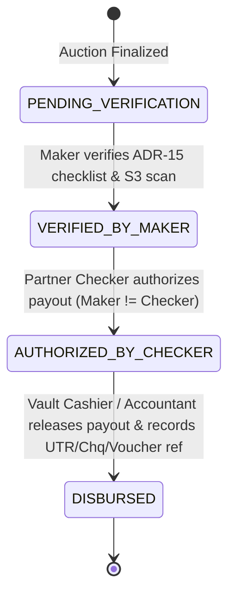

# Prize Money Disbursements Queue & Company Safety Proof Checklist (`/disbursements`)

> **Module**: **Prize Disbursements & Settlement Desk**  
> **Route Paths**: `/disbursements`, `/disbursements/[id]/voucher`  
> **Primary Specification**: [`docs/01-business/decision-log.md`](../01-business/decision-log.md) (ADR-14, ADR-15), [`docs/03-architecture/api-spec.md`](../03-architecture/api-spec.md)  
> **Target Personas**: Super Admin (Partner Maker/Checker), Branch Manager, Accountant, Auditor  
> **Status**: **Task 7.1 Complete & Verified** (160/160 passing tests, 0 TypeScript errors, clean Next.js 15 build)

---

## 1. Architectural Invariants & Business Rules

### 1.1 Pure Whole Rupee Net Prize Math (Guardrail 2 & Chit Fundamentals)
Net Prize Money payable to the auction winner is calculated as:
$$P = V - D$$
where:
- $V$: Gross chit scheme pool value (e.g. ₹1,00,000, ₹5,00,000, ₹10,00,000)
- $D$: Winning auction bid discount entered in auction ($D \le \frac{V}{4}$)
- $C_f$: 4.00% Foreman Commission frozen per ADR-04 ($C_f = V \times 0.04$)
- All numbers operate on 64-bit integer Rupees (`BigInt`); paise, decimal fractions, and IEEE 754 floats are strictly prohibited.

### 1.2 ADR-15: Complete Elimination of Property Documents
Per **ADR-15 (`CONFIRMED-BY-DEVELOPER`)**:
- Traditional property deeds, land registrations, patta records, and encumbrance certificates are **completely eliminated**.
- Collateral/surety is **not mandatory across the board** and is evaluated strictly on-demand for company safety (`isSecurityRequired: boolean`).
- Permitted on-demand safety proof instruments:
  1. Signed formal chit agreement with winner (`agreementSigned: boolean`, mandatory)
  2. Nominee personal guarantee undertaking (`nomineeSigned: boolean`, mandatory)
  3. Signed blank cheques (`blankChequeDetails: string`, optional/on-demand)
  4. Scanned upload of cheques/agreement stored in **private AWS S3** (`POST /api/v1/disbursements/auction/:auctionId/upload-safety-proof`)

### 1.3 ADR-14: Unlimited Hard Cash Prize Disbursements
Per **ADR-14 (`CONFIRMED-BY-DEVELOPER`)**:
- Kumaran Finance operates strictly with physical vault cash and banking instruments in Tamil Nadu.
- The web app enforces **zero artificial cash payout caps** or restrictions.
- Hard cash payouts (`disbursementMode: 'CASH'`) are fully supported for any legal prize amount (e.g., ₹75,000, ₹4,00,000, or higher) with on-counter handover and signed physical voucher receipt.

### 1.4 Private S3 Cloud Storage & 15-Minute Presigned Security URL
- Document scans (JPG, PNG, WEBP, PDF up to 10MB) are uploaded directly to private S3.
- Inspectors (Partner Checker, Super Admin, Auditor) generate a **15-minute time-limited presigned URL** (`GET /api/v1/disbursements/auction/:auctionId/safety-proof-url`, TTL: 900 seconds) for in-office verification.

### 1.5 Dual-Control Workflow State Machine


---

## 2. API Contract & Endpoint Integration

| HTTP Method | API Endpoint | Description | Permitted Roles | Frontend Key |
|---|---|---|---|---|
| `GET` | `/api/v1/disbursements` | Paginated list of disbursements with filters (`status`, `chitGroupId`, `mode`, date range) | `SUPER_ADMIN`, `BRANCH_MANAGER`, `ACCOUNTANT`, `AUDITOR` | `queryKeys.disbursements.list()` |
| `GET` | `/api/v1/disbursements/auction/:auctionId` | Full winner details, ticket, customer, chitGroup, maker/checker audit metadata | `SUPER_ADMIN`, `BRANCH_MANAGER`, `ACCOUNTANT`, `AUDITOR` | `queryKeys.disbursements.detail(auctionId)` |
| `POST` | `/api/v1/disbursements/auction/:auctionId/upload-safety-proof` | Multipart form upload of signed cheques/agreements (max 10MB, JPG/PNG/WEBP/PDF) to private S3 | `SUPER_ADMIN`, `BRANCH_MANAGER`, `ACCOUNTANT` | `SafetyProofUploadBox` component |
| `GET` | `/api/v1/disbursements/auction/:auctionId/safety-proof-url` | Generates 15-minute (900s) time-limited S3 presigned URL for document preview | `SUPER_ADMIN`, `BRANCH_MANAGER`, `ACCOUNTANT`, `AUDITOR` | `queryKeys.disbursements.safetyProofUrl(auctionId)` |
| `POST` | `/api/v1/disbursements/auction/:auctionId/verify-safety-proof` | Maker records ADR-15 verification: `agreementSigned`, `nomineeSigned`, `isSecurityRequired`, `blankChequeDetails`, `securityDocS3Key` | `SUPER_ADMIN`, `BRANCH_MANAGER`, `ACCOUNTANT` | `verifyMutation` in `SafetyProofChecklist` |
| `GET` | `/api/v1/disbursements/auction/:auctionId/voucher` | Generates bilingual formatted voucher (English + தமிழ்) | `SUPER_ADMIN`, `BRANCH_MANAGER`, `ACCOUNTANT`, `AUDITOR` | `queryKeys.disbursements.voucher(auctionId)` |

---

## 3. Frontend Architecture & Modular Component Breakdown

All files are strictly written $\le 300\text{--}350$ lines per **AGENTS.md Rule 4**:

```
apps/web/
├── src/
│   ├── app/(dashboard)/disbursements/
│   │   ├── page.tsx                           # Master queue route with 4 metrics & status tabs (201 lines)
│   │   └── [id]/voucher/page.tsx              # Voucher detail & safety verification route (173 lines)
│   ├── components/disbursements/
│   │   ├── disbursements-table.tsx            # Master disbursements data table with status badges (251 lines)
│   │   ├── safety-proof-checklist.tsx         # Maker verification form with ADR-15 checklist (318 lines)
│   │   ├── safety-proof-upload-box.tsx        # S3 multipart upload & 15-min presigned URL preview (138 lines)
│   │   └── payout-voucher-card.tsx            # 4-column financial breakdown, progress stepper & ADR-14 banner (260 lines)
│   └── lib/
│       ├── date-utils.ts                      # Localized Indian date formatting helper (formatDate)
│       └── query-keys.ts                      # Deterministic TanStack Query cache invalidation graph
└── test/
    └── prize-disbursements.spec.ts            # 8 automated invariant test suites (372 lines)
```

---

## 4. Verification & Automated Test Suite Proofs

The dedicated test suite `apps/web/test/prize-disbursements.spec.ts` verifies all 8 core invariants:

```
▶ Task 7.1: Prize Disbursements Queue & Safety Proof Checklist Unit Tests
  ✔ Financial Invariant: Net Prize Money is strictly P = V - D in whole integer Rupees (2.0674ms)
  ✔ ADR-15 Invariant: Property documents (deeds/patta) are eliminated from checklist & DTO (0.493ms)
  ✔ ADR-15 Invariant: Mandatory boolean signatures for chit agreement & nominee guarantee (0.3837ms)
  ✔ Disbursement Workflow: Transitions PENDING_VERIFICATION to VERIFIED_BY_MAKER with Maker stamp (1.4075ms)
  ✔ S3 Upload Guard: Allows JPG, PNG, WEBP, PDF up to 10MB and rejects invalid MIME/size (0.5914ms)
  ✔ S3 Presigned URL Security Guard: Viewing URL expires in strictly 900 seconds (15 minutes) (2.7363ms)
  ✔ ADR-14 Invariant: Unlimited hard cash payouts permitted with zero artificial software caps (1.767ms)
  ✔ Bilingual Parity: 100% key match between en.json and ta.json in disbursements namespace (4.3092ms)
✔ Task 7.1: Prize Disbursements Queue & Safety Proof Checklist Unit Tests (17.54ms)
ℹ tests 8, suites 1, pass 8, fail 0
```

Across the full web workspace:
- **Total Test Count**: **160 / 160 tests passing** (100% pass rate)
- **TypeScript Typecheck**: `tsc --noEmit` exited with **0 errors**
- **Production Build**: `next build` compiled all routes including `/disbursements` and `/disbursements/[id]/voucher` cleanly into optimized server-rendered pages.
- **Bilingual Parity**: 81 keys in `en.json` $\longleftrightarrow$ 81 keys in `ta.json` under `disbursements` (0 missing).
