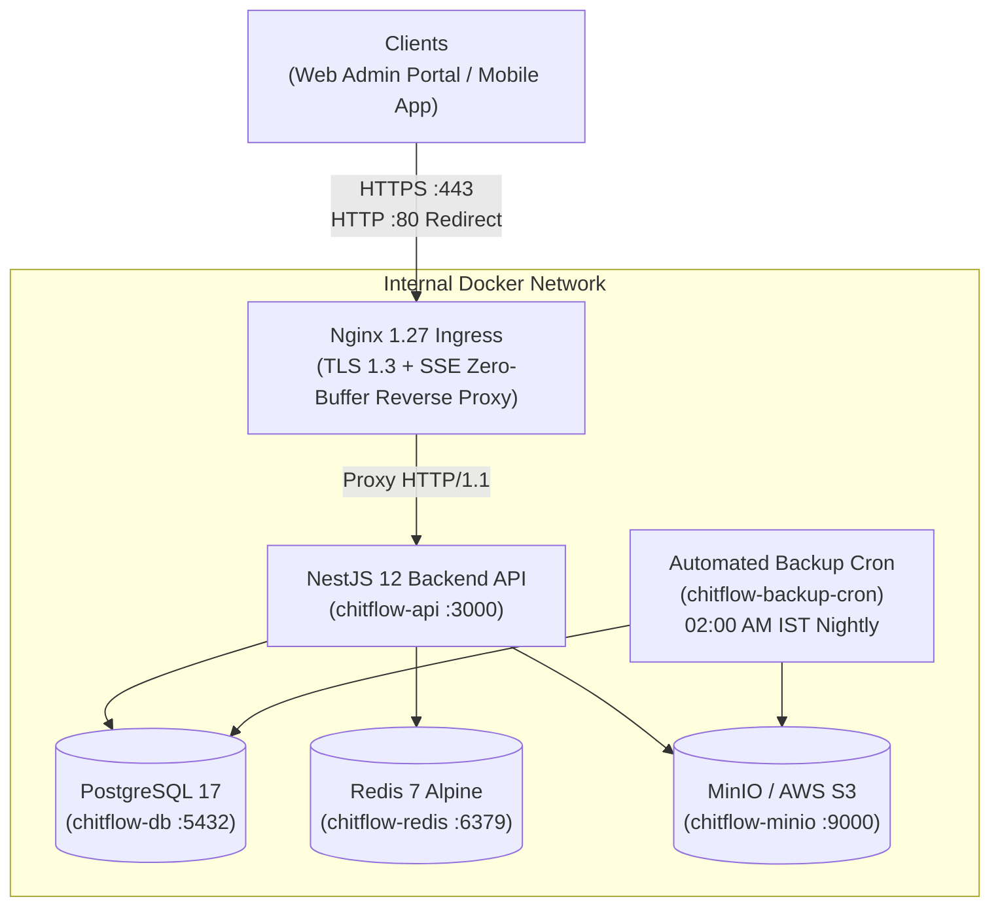

# Kumaran Chits — Production Deployment & Operations Guide

> **Platform**: **Kumaran Chits** (Kumaran Finance, Perundurai, Tamil Nadu)  
> **Target OS**: Ubuntu 24.04 LTS (AWS EC2 / Self-Hosted VPS)  
> **Orchestration**: Docker Compose v2 (Modular Production Parity)  
> **Key Guardrails**: PostgreSQL 17 Port 5433, Native `BigInt` Math, TLS 1.3, Zero Buffer SSE, Automated 02:00 AM IST Off-Site Backup

---

## 1. Production Architecture Overview

The Kumaran Chits production environment orchestrates 6 containerized services with automated health checks and persistent volume storage:



| Container | Service Name | Internal Port | Host Port | Purpose |
|---|---|---|---|---|
| `chitflow-nginx` | `nginx` | `80`, `443` | `80`, `443` | Ingress reverse proxy, TLS termination, SSE unbuffered streaming |
| `chitflow-api` | `api` | `3000` | `127.0.0.1:3000` | NestJS 12 backend modular monolith |
| `chitflow-db` | `db` | `5432` | `127.0.0.1:5433` | PostgreSQL 17 database (Sole source of financial truth) |
| `chitflow-redis` | `redis` | `6379` | `127.0.0.1:6379` | Redis 7 queue broker for BullMQ background workers |
| `chitflow-minio` | `minio` | `9000`, `9001` | `127.0.0.1:9000` | Private S3-compatible document storage (KYC scans & PDF receipts) |
| `chitflow-backup-cron` | `backup-cron` | N/A | N/A | Autonomous cron worker executing encrypted S3 pg_dump at 02:00 AM IST |

---

## 2. Server Prerequisites & Initialization

### 2.1 Hardware Requirements
- **CPU**: 2 vCPU or higher (4 vCPU recommended)
- **RAM**: 4 GB minimum (8 GB recommended)
- **Disk**: 50 GB NVMe / SSD (Encrypted with LUKS / AWS KMS)

### 2.2 Host Package Installation (Ubuntu 24.04 LTS)
```bash
# Update repositories and install Docker Engine & Compose
sudo apt-get update && sudo apt-get install -y ca-certificates curl gnupg
sudo install -m 0755 -d /etc/apt/keyrings
curl -fsSL https://download.docker.com/linux/ubuntu/gpg | sudo gpg --dearmor -o /etc/apt/keyrings/docker.gpg
sudo chmod a+r /etc/apt/keyrings/docker.gpg

echo "deb [arch=$(dpkg --print-architecture) signed-by=/etc/apt/keyrings/docker.gpg] https://download.docker.com/linux/ubuntu $(. /etc/os-release && echo "$VERSION_CODENAME") stable" | sudo tee /etc/apt/sources.list.d/docker.list > /dev/null

sudo apt-get update && sudo apt-get install -y docker-ce docker-ce-cli containerd.io docker-buildx-plugin docker-compose-plugin
```

---

## 3. SSL / TLS Certificate Setup

### Option A: Production Setup with Let's Encrypt & Certbot (Recommended)
1. Point your domain DNS records (`kumaranfinance.com` and `www.kumaranfinance.com`) to your server's public IP.
2. Generate certificates using Certbot standalone mode:
   ```bash
   sudo apt-get install -y certbot
   sudo certbot certonly --standalone -d kumaranfinance.com -d www.kumaranfinance.com --agree-tos -m admin@kumaranfinance.com
   ```
3. Link the certificates into the Nginx SSL directory:
   ```bash
   sudo mkdir -p infra/docker/nginx/ssl/live
   sudo cp /etc/letsencrypt/live/kumaranfinance.com/fullchain.pem infra/docker/nginx/ssl/live/
   sudo cp /etc/letsencrypt/live/kumaranfinance.com/privkey.pem infra/docker/nginx/ssl/live/
   ```

### Option B: Staging / Local Development (Self-Signed Certificates)
Run the automated generator script:
```bash
# On Linux / POSIX:
chmod +x infra/docker/nginx/ssl/generate-self-signed.sh
./infra/docker/nginx/ssl/generate-self-signed.sh

# On Windows PowerShell:
.\infra\docker\nginx\ssl\generate-self-signed.ps1
```

---

## 4. Starting the Full-Stack Production Environment

1. **Configure Environment Variables**:
   ```bash
   cd infra/docker
   cp .env.example .env
   # Edit .env with secure production passwords and secrets
   nano .env
   ```
2. **Build and Start Containers**:
   ```bash
   docker compose -f docker-compose.fullstack.yml up -d --build
   ```
3. **Verify Container Health**:
   ```bash
   docker compose -f docker-compose.fullstack.yml ps
   ```
   All 6 services (`chitflow-db`, `chitflow-redis`, `chitflow-minio`, `chitflow-api`, `chitflow-nginx`, and `chitflow-backup-cron`) should report `healthy` or `running`.

---

## 5. Server-Sent Events (SSE) Reverse Proxy Verification

The live Maker-Checker Approvals stream (`/api/v1/reports/approvals-stream`) requires zero buffering. Verify that the Nginx reverse proxy streams without buffering or timeouts:

```bash
# Test SSE stream using curl (with -N to disable client buffering)
curl -N -k -H "Authorization: Bearer <SUPER_ADMIN_JWT_TOKEN>" https://localhost/api/v1/reports/approvals-stream
```

**Expected Response**:
```text
data: {"type":"APPROVALS_UPDATE","summary":{"totalPendingCount":2,"cashHandoversCount":1,"disbursementAuthorizationsCount":1,"paymentReversalsCount":0,"safetyProofVerificationsCount":0,"cashHandoversTotalAmount":"7900","disbursementsTotalAmount":"75000","reversalsTotalAmount":"0"},"timestamp":"2026-10-21T15:30:00.000Z"}
```
*(The connection will remain active and emit an updated payload every 15 seconds).*

---

## 6. Automated Nightly Database Backups (02:00 AM IST)

### 6.1 Schedule & Operation
- The `chitflow-backup-cron` container runs `crond` scheduled for `02:00 AM IST` (`30 20 * * *` UTC).
- Dumps PostgreSQL database using custom binary format (`pg_dump -F c`).
- Uploads directly to private AWS S3 / MinIO under `backups/db/YYYY/MM/kumaran_chits_backup_YYYYMMDD_HHMMSS.dump`.
- Prunes local dumps older than 7 days and enforces 30-day S3 retention.

### 6.2 Manual Backup Trigger (On-Demand Snapshot)
To take an immediate database snapshot without waiting for 02:00 AM:
```bash
docker exec chitflow-backup-cron /scripts/backup-cron-job.sh
```

### 6.3 Inspecting Backup Logs
```bash
docker exec chitflow-backup-cron cat /var/log/backup-cron.log
```

---

## 7. Disaster Recovery & Database Restoration

To restore a database dump from S3:
```bash
# Via npm script:
pnpm --filter api db:restore:s3

# Or perform an automated Quarterly DRP Drill:
pnpm --filter api db:drp-drill
```
See [`docs/06-devops/infrastructure-and-drp.md`](../../docs/06-devops/infrastructure-and-drp.md) for full disaster recovery protocols.
