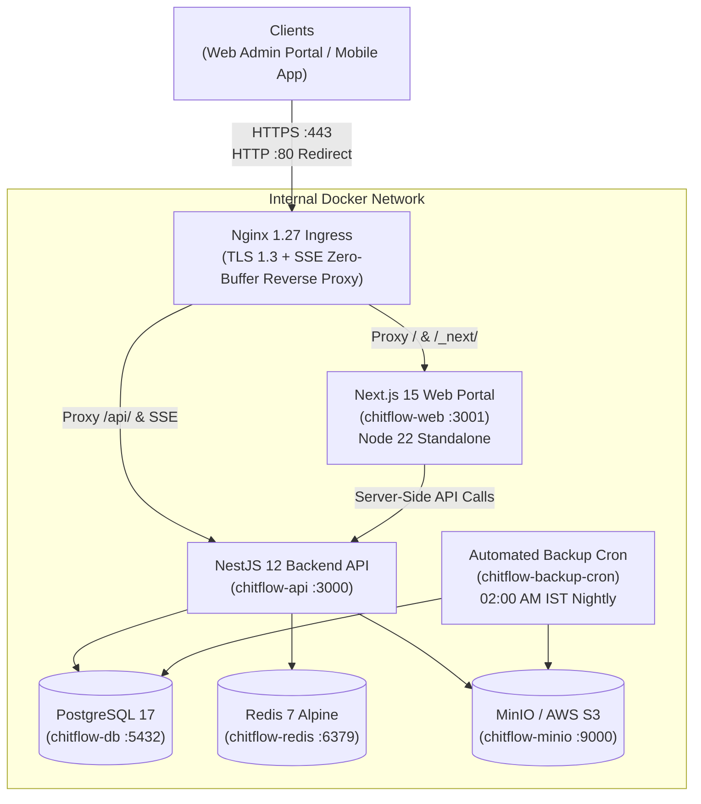

# Kumaran Chits — Production Deployment & Operations Guide

> **Platform**: **Kumaran Chits** (Kumaran Finance, Perundurai, Tamil Nadu)  
> **Target OS**: Ubuntu 24.04 LTS (AWS EC2 / Self-Hosted VPS)  
> **Orchestration**: Docker Compose v2 (Modular Production Parity)  
> **Key Guardrails**: PostgreSQL 17 Port 5433, Native `BigInt` Math, TLS 1.3, Zero Buffer SSE, Automated 02:00 AM IST Off-Site Backup

---

## 1. Production Architecture Overview

The Kumaran Chits production environment orchestrates 6 containerized services with automated health checks and persistent volume storage:



| Container | Service Name | Internal Port | Host Port | Purpose |
|---|---|---|---|---|
| `chitflow-nginx` | `nginx` | `80`, `443` | `80`, `443` | Ingress reverse proxy, TLS termination, SSE unbuffered streaming |
| `chitflow-web` | `web` | `3001` | `127.0.0.1:3001` | Next.js 15 operations dashboard (Node 22 Alpine standalone ~100MB) |
| `chitflow-api` | `api` | `3000` | `127.0.0.1:3000` | NestJS 12 backend modular monolith |
| `chitflow-db` | `db` | `5432` | `127.0.0.1:5433` | PostgreSQL 17 database (Sole financial truth; max_connections=150, statement_timeout=15s, lock_timeout=5s) |
| `chitflow-redis` | `redis` | `6379` | `127.0.0.1:6379` | Redis 7 queue broker for BullMQ background workers |
| `chitflow-minio` | `minio` | `9000`, `9001` | `127.0.0.1:9000` | Private S3-compatible document storage (KYC scans & PDF receipts) |
| `chitflow-backup-cron` | `backup-cron` | N/A | N/A | Autonomous cron worker executing encrypted S3 pg_dump at 02:00 AM IST |

### 1.1 Database Concurrency & Connection Sizing Guardrails
- **PostgreSQL Max Connections**: Configured to `150` with `512MB` shared buffers.
- **Server-Side Safety Timeouts**: `statement_timeout = 15000` (15s query termination), `lock_timeout = 5000` (5s lock wait abort).
- **Prisma Connection Pool**: Sized explicitly in `DATABASE_URL` via `&connection_limit=25&pool_timeout=10` (budgets 25 connections per API replica, preventing connection exhaustion).
- **Container Log Limits**: Global JSON-file logging bounded to `max-size: 50m` and `max-file: 5` across all services to prevent disk exhaustion.

---

## 2. Server Prerequisites & Initialization

### 2.1 Hardware Requirements
- **CPU**: 2 vCPU or higher (4 vCPU recommended)
- **RAM**: 4 GB minimum (8 GB recommended)
- **Disk**: 50 GB NVMe / SSD (Encrypted with LUKS / AWS KMS)

### 2.2 Host Package Installation (Ubuntu 24.04 LTS)
```bash
# Update repositories and install Docker Engine & Compose
sudo apt-get update && sudo apt-get install -y ca-certificates curl gnupg
sudo install -m 0755 -d /etc/apt/keyrings
curl -fsSL https://download.docker.com/linux/ubuntu/gpg | sudo gpg --dearmor -o /etc/apt/keyrings/docker.gpg
sudo chmod a+r /etc/apt/keyrings/docker.gpg

echo "deb [arch=$(dpkg --print-architecture) signed-by=/etc/apt/keyrings/docker.gpg] https://download.docker.com/linux/ubuntu $(. /etc/os-release && echo "$VERSION_CODENAME") stable" | sudo tee /etc/apt/sources.list.d/docker.list > /dev/null

sudo apt-get update && sudo apt-get install -y docker-ce docker-ce-cli containerd.io docker-buildx-plugin docker-compose-plugin
```

---

## 3. SSL / TLS Certificate Setup

### Option A: Production Setup with Let's Encrypt & Certbot (Recommended)
1. Point your domain DNS records (`kumaranfinance.in` and `www.kumaranfinance.in`) to your server's public IP.
2. Generate certificates using Certbot standalone mode:
   ```bash
   sudo apt-get install -y certbot
   sudo certbot certonly --standalone -d kumaranfinance.in -d www.kumaranfinance.in --agree-tos -m admin@kumaranfinance.in
   ```
3. Link the certificates into the Nginx SSL directory:
   ```bash
   sudo mkdir -p infra/docker/nginx/ssl/live
   sudo cp /etc/letsencrypt/live/kumaranfinance.in/fullchain.pem infra/docker/nginx/ssl/live/
   sudo cp /etc/letsencrypt/live/kumaranfinance.in/privkey.pem infra/docker/nginx/ssl/live/
   ```

### Option B: Staging / Local Development (Self-Signed Certificates)
Run the automated generator script:
```bash
# On Linux / POSIX:
chmod +x infra/docker/nginx/ssl/generate-self-signed.sh
./infra/docker/nginx/ssl/generate-self-signed.sh

# On Windows PowerShell:
.\infra\docker\nginx\ssl\generate-self-signed.ps1
```

---

## 4. Starting the Full-Stack Production Environment

1. **Configure Environment Variables**:
   ```bash
   cd infra/docker
   cp .env.example .env
   # Edit .env with secure production passwords and secrets
   nano .env
   ```
2. **Build and Start Containers**:
   ```bash
   docker compose -f docker-compose.fullstack.yml up -d --build
   ```
3. **Verify Container Health**:
   ```bash
   docker compose -f docker-compose.fullstack.yml ps
   ```
   All 6 services (`chitflow-db`, `chitflow-redis`, `chitflow-minio`, `chitflow-api`, `chitflow-nginx`, and `chitflow-backup-cron`) should report `healthy` or `running`.

---

## 5. Server-Sent Events (SSE) Reverse Proxy Verification

The live Maker-Checker Approvals stream (`/api/v1/reports/approvals-stream`) requires zero buffering. Verify that the Nginx reverse proxy streams without buffering or timeouts:

```bash
# Test SSE stream using curl (with -N to disable client buffering)
curl -N -k -H "Authorization: Bearer <SUPER_ADMIN_JWT_TOKEN>" https://localhost/api/v1/reports/approvals-stream
```

**Expected Response**:
```text
data: {"type":"APPROVALS_UPDATE","summary":{"totalPendingCount":2,"cashHandoversCount":1,"disbursementAuthorizationsCount":1,"paymentReversalsCount":0,"safetyProofVerificationsCount":0,"cashHandoversTotalAmount":"7900","disbursementsTotalAmount":"75000","reversalsTotalAmount":"0"},"timestamp":"2026-10-21T15:30:00.000Z"}
```
*(The connection will remain active and emit an updated payload every 15 seconds).*

---

## 6. Automated Nightly Database Backups (02:00 AM IST)

### 6.1 Schedule & Operation
- The `chitflow-backup-cron` container runs `crond` scheduled for `02:00 AM IST` (`30 20 * * *` UTC).
- Dumps PostgreSQL database using custom binary format (`pg_dump -F c`).
- Uploads directly to private AWS S3 / MinIO under `backups/db/YYYY/MM/kumaran_chits_backup_YYYYMMDD_HHMMSS.dump`.
- Prunes local dumps older than 7 days and enforces 30-day S3 retention.

### 6.2 Manual Backup Trigger (On-Demand Snapshot)
To take an immediate database snapshot without waiting for 02:00 AM:
```bash
docker exec chitflow-backup-cron /scripts/backup-cron-job.sh
```

### 6.3 Inspecting Backup Logs
```bash
docker exec chitflow-backup-cron cat /var/log/backup-cron.log
```

---

## 7. Disaster Recovery & Database Restoration

To restore a database dump from S3:
```bash
# Via npm script:
pnpm --filter api db:restore:s3

# Or perform an automated Quarterly DRP Drill:
pnpm --filter api db:drp-drill
```
See [`docs/06-devops/infrastructure-and-drp.md`](../../docs/06-devops/infrastructure-and-drp.md) for full disaster recovery protocols.

---

## 8. High-Load Resilience, Keep-Alive & Payload Configuration

### 8.1 HTTP Keep-Alive Alignment (Zero 502 Bad Gateway ECONNRESET)
To prevent race conditions where Nginx sends a request on an idle connection that Node.js has closed:
- **Nginx Ingress**: `keepalive_timeout 65s` (`nginx.conf`)
- **NestJS Node Server**: `keepAliveTimeout = 70000ms (70s)`, `headersTimeout = 71000ms (71s)` (`main.ts`)
- **Rule**: Upstream Node.js server keepalive **must exceed** ingress proxy keepalive by $\ge 5$ seconds.

### 8.2 Payload Limits & Bulkhead Isolation
- **Global API Body Size**: Restricted to `1 MB` (`client_max_body_size 1M;` in Nginx and Express JSON parser) to prevent memory exhaustion and payload flood attacks.
- **Document & Safety Proof Scoped Uploads**: Extended to `25 MB` strictly for KYC documents (`/api/v1/customers/:id/documents`) and loan safety proof uploads (`/api/v1/disbursements/auction/:auctionId/upload-safety-proof`).

### 8.3 Ingress Rate Limiting & Retry-After Contract
- **Auth Limits**: `3 req/s` with burst 5 on `/api/v1/auth/`
- **General API Limits**: `30 req/s` with burst 30 on `/api/`
- **Rejection Behavior**: Returns HTTP `429 Too Many Requests` with a standard JSON envelope and `Retry-After: 60` response header at both Nginx edge and application layers.

### 8.4 Libuv Thread Pool Sizing (Zero Starvation on Bcrypt Operations)
- **Setting**: `ENV UV_THREADPOOL_SIZE=16` in `apps/api/Dockerfile` and `docker-compose.fullstack.yml`.
- **Sizing Rule**: Password/MPIN authentication uses `BCRYPT_SALT_ROUNDS = 12` (~300ms compute time per login). With 16 libuv threads, concurrent logins cannot starve asynchronous file system, DNS, or socket operations.

### 8.5 Process Bulkhead Isolation & Producer/Worker Scaling (`ENABLE_BULLMQ_WORKERS`)
- **Default**: `ENABLE_BULLMQ_WORKERS=true` runs background queue workers inside the API instance.
- **Dedicated Worker Containers (High-Load)**:
  - API Container: `ENABLE_BULLMQ_WORKERS=false` (producer-only, pure REST handling).
  - Worker Container: `ENABLE_BULLMQ_WORKERS=true` running command `node dist/main.js` without public ingress exposure.

---

## 9. Zero-Downtime Blue-Green Deployment & Multi-Instance Operations

### 9.1 Zero-Downtime Hot Deployment Automation
In production, standard `docker compose up -d --build` causes 5–15 seconds of service interruption as containers restart. To achieve 100% continuous availability with zero dropped requests:

```bash
# On Linux / Production Server:
chmod +x infra/scripts/zero-downtime-deploy.sh
./infra/scripts/zero-downtime-deploy.sh

# On Windows PowerShell:
.\infra\scripts\zero-downtime-deploy.ps1
```

**Automated Deployment Sequence**:
1. Pre-builds the updated API container image.
2. Starts the target container instance while keeping the existing container alive.
3. Polls the deep readiness health probe (`/health/readiness`) every 2 seconds until HTTP 200 is confirmed.
4. Executes zero-downtime Nginx hot reload (`nginx -s reload`).
5. Allows a 15-second socket draining window for in-flight requests before terminating the old container.

### 9.2 Deep Health Checks & Container Probing Standards
The API exposes dedicated health probe endpoints tailored for load balancers and orchestrators:
- **Readiness Probe (`GET /health/readiness` or `/health`)**: Probes live PostgreSQL connectivity (`SELECT 1`) and Redis queue responsiveness (`PING`). Returns `HTTP 200` when healthy; returns `HTTP 503 Service Unavailable` if backing services degrade. Load balancers use this to route customer traffic.
- **Liveness Probe (`GET /health/liveness`)**: Pure in-process check verifying the Node.js event loop is responsive. Used by Kubernetes/ECS to detect process deadlocks without restarting containers during transient database spikes.

### 9.3 Multi-Instance Configuration & Environment Verification
Before deploying new replicas or initiating scaling, verify environment variable consistency:
```bash
# Verify configuration consistency across nodes:
./infra/scripts/verify-config.sh infra/docker/.env
```

### 9.4 Database Connection Pool Allocation Budget
PostgreSQL 17 is configured with `max_connections = 150`. To guarantee zero pool exhaustion across horizontally scaled instances:
- **Each API Replica**: Sized to `25` connections via `&connection_limit=25&pool_timeout=10` in `DATABASE_URL`.
- **2 Active API Instances**: $2 \times 25 = 50$ connections.
- **Dedicated BullMQ Worker**: `15` connections.
- **Admin, Migrations & Backup Margin**: $150 - (50 + 15) = 85$ reserve connections for `pg_dump`, DRP drills, and Prisma CLI.
