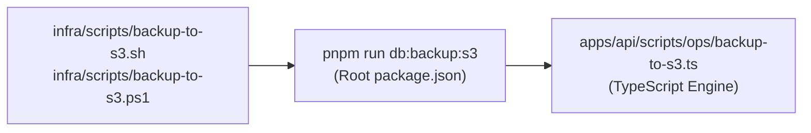

# Kumaran Chits — Infrastructure & Host Operations Scripts

> **Product**: **Kumaran Chits** (Kumaran Finance, Perundurai, Tamil Nadu)  
> **Directory**: `infra/scripts/`  
> **Target Audience**: DevOps Engineers, Site Reliability Engineers, and System Administrators  
> **Primary Guides**: [`docs/06-devops/infrastructure-and-drp.md`](../../docs/06-devops/infrastructure-and-drp.md), [`docs/07-operations/PRODUCTION-DEPLOYMENT-GUIDE.md`](../../docs/07-operations/PRODUCTION-DEPLOYMENT-GUIDE.md)

---

## 1. Overview & Operational Responsibilities

This directory contains host-level, platform-agnostic automation scripts for managing Docker containers, production Linux VPS environments, Let's Encrypt certificates, disk capacity, and disaster recovery.

Scripts are provided in pairs:
- **POSIX Bash (`.sh`)**: For production Linux VPS (Debian, Ubuntu, Alpine) and CI runners.
- **PowerShell (`.ps1`)**: For local Windows development workstations.

---

## 2. Script Inventory & Taxonomy

| Script Pair | Domain | Purpose | Execution Context |
|---|---|---|---|
| [`backup-cron-job.sh`](backup-cron-job.sh) | **Automated Backup** | Nightly S3 backup runner (`30 20 * * *` UTC / `02:00 AM IST`) inside the `chitflow-backup-cron` container. Uses `pg_dump -F c` and AWS CLI. | Alpine Container |
| [`backup-db.sh`](backup-db.sh) / [`.ps1`](backup-db.ps1) | **Host DB Dump** | Direct binary PostgreSQL dump (`pg_dump -F c`) from `chitflow-db` into `infra/backups/`. | Host OS (Docker) |
| [`restore-db.sh`](restore-db.sh) / [`.ps1`](restore-db.ps1) | **Host DB Restore** | Direct binary PostgreSQL restore (`pg_restore`) into `chitflow-db` from `infra/backups/`. | Host OS (Docker) |
| [`backup-to-s3.sh`](backup-to-s3.sh) / [`.ps1`](backup-to-s3.ps1) | **S3 Backup CLI** | Convenience shell runner delegating to `pnpm run db:backup:s3` (executes [`apps/api/scripts/ops/backup-to-s3.ts`](../../apps/api/scripts/ops/backup-to-s3.ts)). | Host OS (pnpm) |
| [`restore-from-s3.sh`](restore-from-s3.sh) / [`.ps1`](restore-from-s3.ps1) | **S3 Restore CLI** | Convenience shell runner delegating to `pnpm run db:restore:s3` (executes [`apps/api/scripts/ops/restore-from-s3.ts`](../../apps/api/scripts/ops/restore-from-s3.ts)). | Host OS (pnpm) |
| [`drp-drill.sh`](drp-drill.sh) / [`.ps1`](drp-drill.ps1) | **DRP Drill Engine** | Convenience shell runner delegating to `pnpm run db:drp:drill` (executes [`apps/api/scripts/ops/drp-drill.ts`](../../apps/api/scripts/ops/drp-drill.ts)). | Host OS (pnpm) |
| [`zero-downtime-deploy.sh`](zero-downtime-deploy.sh) / [`.ps1`](zero-downtime-deploy.ps1) | **VPS Deployment** | Zero-downtime rolling deployment orchestrator for production VPS with health probes. | Host OS |
| [`rollback.sh`](rollback.sh) / [`.ps1`](rollback.ps1) | **VPS Rollback** | Automated rollback to previous stable Docker image / git commit upon failed deployment. | Host OS |
| [`cert-monitor.sh`](cert-monitor.sh) / [`.ps1`](cert-monitor.ps1) | **Security Ops** | Checks SSL/TLS certificate expiration date and alerts if `< 14 days` remain. | Cron / Pre-Deploy |
| [`disk-monitor.sh`](disk-monitor.sh) / [`.ps1`](disk-monitor.ps1) | **Capacity Ops** | Verifies VPS disk utilization and warns if usage exceeds 85%. | Cron / Pre-Deploy |
| [`verify-config.sh`](verify-config.sh) / [`.ps1`](verify-config.ps1) | **Configuration** | Validates environment variables, ports, and Docker network prerequisites. | CI / Pre-Deploy |

---

## 3. Delegation to pnpm Canonical Entrypoints

To avoid dual maintenance, all shell runners for application-level TypeScript tools delegate to canonical root npm scripts:



---

## 4. Docker Volume Mounting Guardrail

The `chitflow-backup-cron` container in [`infra/docker/docker-compose.fullstack.yml`](../docker/docker-compose.fullstack.yml#L272) mounts:
```yaml
volumes:
  - ../scripts:/scripts:ro
  - ../backups:/backups
```
Therefore, [`backup-cron-job.sh`](backup-cron-job.sh) **must strictly remain at the root of `infra/scripts/`** to avoid breaking the automated backup cron container.
